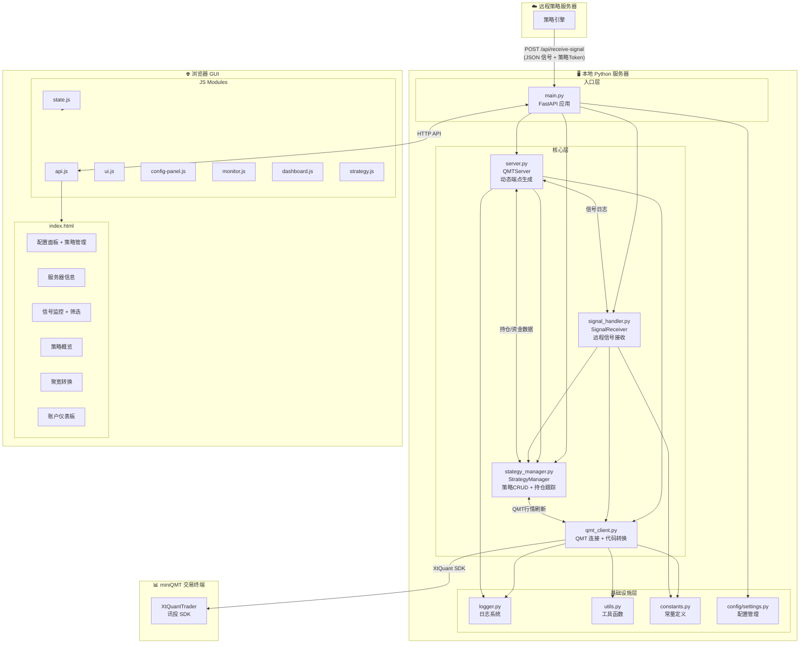
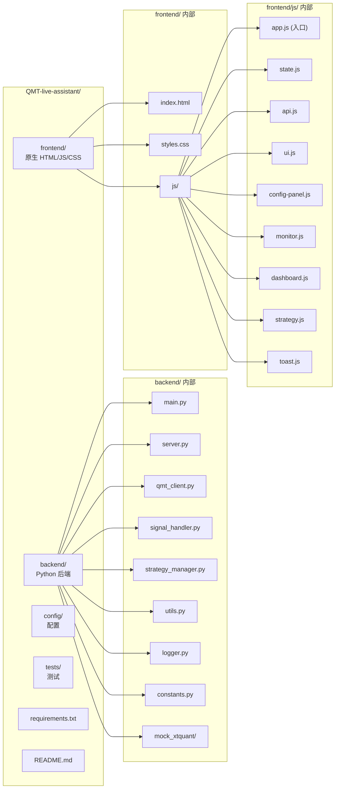
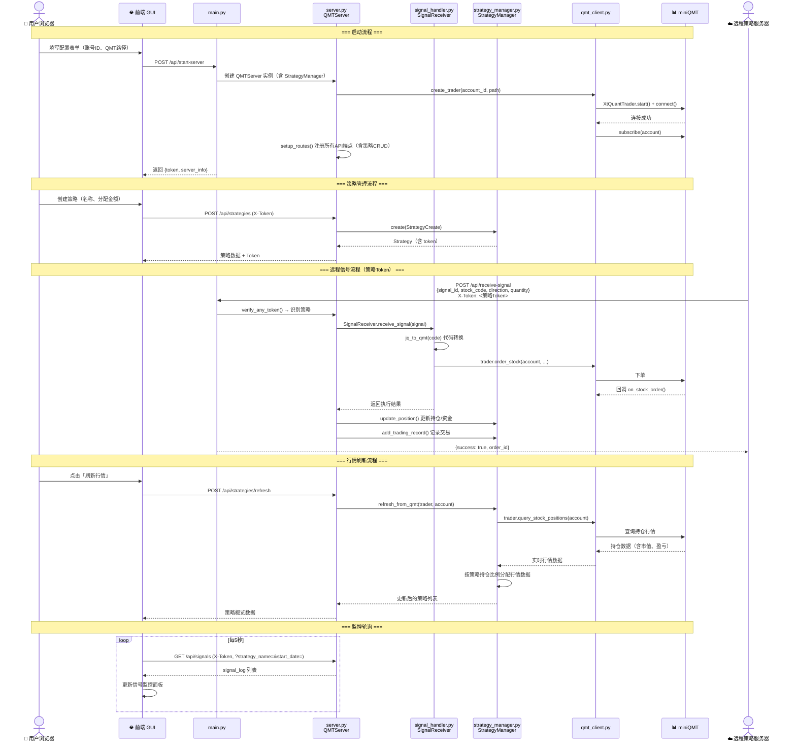
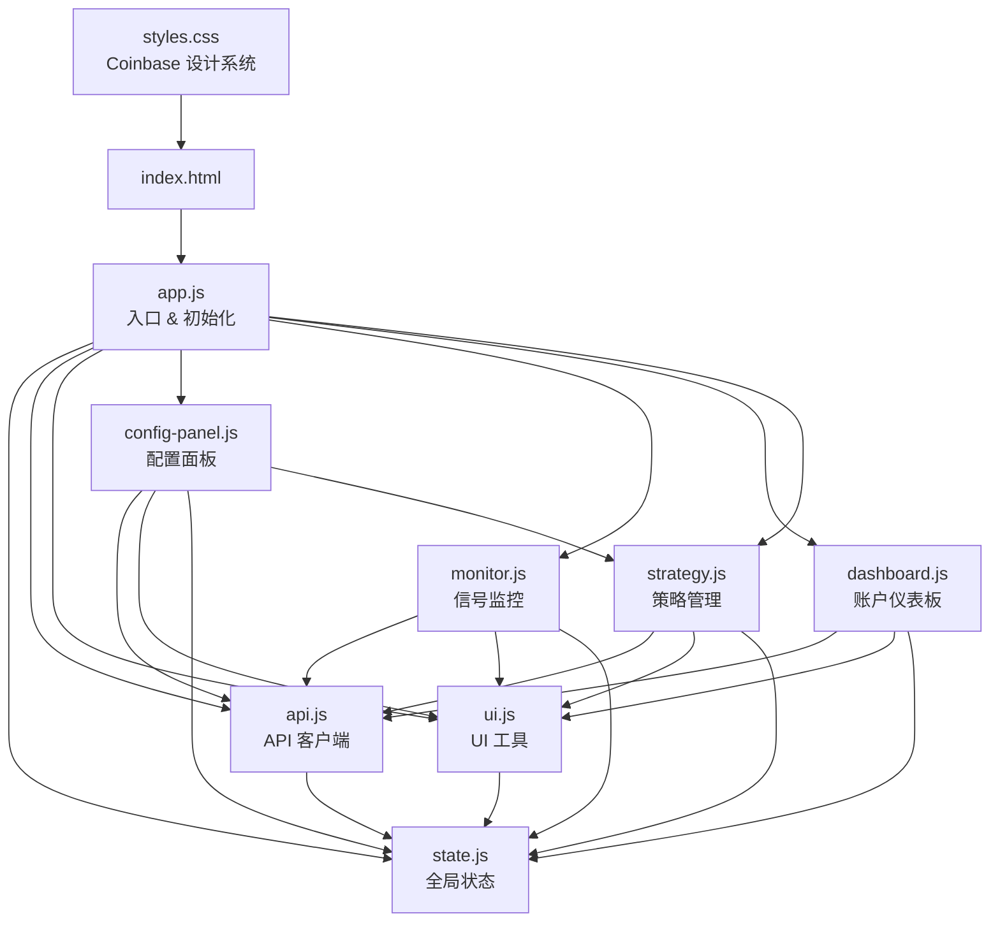
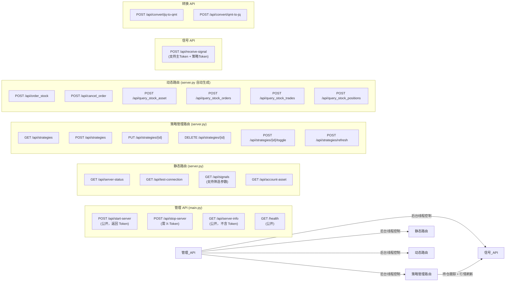

# QMT-live-assistant 实现方案

## Context

根据 PR.md 需求，构建一个基于 Python 服务器 + 原生 HTML 前端的 miniQMT 量化交易助手。UI 设计采用 DESIGN.md 中定义的 Coinbase 风格。项目 MVP 包括：启动 miniQMT 连接、测试获取可用资金、聚宽代码转换、信号监控。功能升级包括：多策略管理、策略级资金分配与持仓跟踪、策略 Token 认证、信号筛选。

## 技术栈

- **后端**: Python 3.10+ / FastAPI / uvicorn / xtquant SDK
- **前端**: 原生 HTML + CSS + JS（无框架，ES Module）
- **设计**: Coinbase 设计系统（#0052ff 主色，Inter 字体，pill 按钮，24px 卡片圆角）

## 项目架构图示

### 1. 整体系统架构



### 2. 项目目录结构



### 3. 核心数据流



### 4. 前端模块依赖图



### 5. API 路由拓扑



---

## 后端架构

### 1. `config/settings.py` — 配置层
- 从环境变量读取：SERVER_HOST, SERVER_PORT, MINI_QMT_PATH, ACCOUNT_ID, SECRET_KEY, LOG_LEVEL, WECHAT_WEBHOOK_URL
- 提供合理的默认值
- 导出单例 settings 对象

### 2. `backend/constants.py` — 常量
- ANSI 颜色码（RED, GREEN, YELLOW, BLUE, RESET）
- 订单状态映射（48→未报, 56→已成 等）
- 买卖方向映射

### 3. `backend/logger.py` — 日志（qka 模式）
- `create_logger(name)` — 控制台 handler + 按日文件轮转（logs/YYYY-MM-DD.log）
- `WeChatHandler(logging.Handler)` — 企业微信 webhook 推送
- `add_wechat_handler(logger, level, webhook_url)`

### 4. `backend/utils.py` — 工具函数（qka 模式）
- `add_stock_suffix(code)` — 6位代码补全后缀（600000→600000.SH）
- `timestamp_to_datetime_string(ts)` — 时间戳转字符串
- `parse_order_type(order_type)` — 订单类型 int→中文

### 5. `backend/qmt_client.py` — QMT 连接层
遵循 qka `trade.py` 的精确模式：
- `MyXtQuantTraderCallback(XtQuantTraderCallback)` — 回调处理器
  - `on_disconnected()`, `on_stock_order()`, `on_stock_trade()`, `on_order_error()`, `on_cancel_error()`
  - 将事件追加到共享的 `signal_log` deque 中
- `create_trader(account_id, mini_qmt_path)` → `(trader, account, callback)`
  - `session_id = random.randint(100000, 999999)`（qka 模式）
  - `xt_trader = XtQuantTrader(path, session_id)`
  - `xt_trader.start()` → `xt_trader.connect()`
  - `account = StockAccount(account_id)`
  - `xt_trader.subscribe(account)`（qka 模式）
  - `xt_trader.register_callback(callback)`
- `jq_to_qmt(code)` / `qmt_to_jq(code)` — 聚宽格式转换
  - XSHE→SZ, XSHG→SH, XBJ→BJ

### 6. `backend/strategy_manager.py` — 策略管理器
`Strategy` Pydantic 模型：
- id（自动生成 12 位 hex）、name、description、enabled
- token（自动生成 32 位 hex，用于远程信号认证）
- allocated_funds（分配金额）、available_cash（可用资金）
- total_asset（总资产）、daily_pnl（当日盈亏，从 QMT 行情计算）
- positions（持仓数组：stock_code, quantity, avg_cost, current_price, market_value, daily_pnl）
- trading_records（买卖记录数组）

`StrategyManager` 类：
- CRUD：create, get, list_all, update, delete, toggle
- `find_by_token(token)` — 按 Token 查找策略
- `update_position(...)` — 买/卖后更新持仓数量和可用资金
- `add_trading_record(...)` — 添加买卖记录
- `refresh_from_qmt(trader, account)` — 从 QMT 查询实时持仓，按各策略持仓比例分配 market_value 和 daily_pnl

### 7. `backend/server.py` — 核心服务器（qka 模式）
`QMTServer` 类：
- `__init__` — 创建 StrategyManager 实例
- `generate_token()` — `secrets.token_hex(32)` 随机生成 64 字符安全 Token
- `verify_token(x_token)` — FastAPI 依赖，校验主 Token
- `verify_any_token(x_token)` — 同时校验主 Token 和所有已启用策略的 Token
- `init_trader()` — 调用 create_trader
- `convert_to_dict(obj)` — 递归转换 XtQuant 对象为 dict
- `setup_routes()` — 注册所有端点（动态 + 静态 + 策略 CRUD）
  - 策略 CRUD：GET/POST `/api/strategies`、PUT/DELETE `/api/strategies/{id}`、POST toggle、POST refresh
  - `GET /api/signals` — 支持 `start_date`、`end_date`、`strategy_name` 筛选
  - `POST /api/receive-signal` — 支持策略 Token，自动关联策略并更新持仓
- `init_and_setup()` → `run()` → `stop()`

### 8. `backend/signal_handler.py` — 远程信号接收
`TradeSignal` Pydantic 模型：
- signal_id, stock_code (聚宽格式), direction (buy/sell), quantity, price (可选), order_type, strategy_name, timestamp

`SignalReceiver` 类：
- 接受 `strategy_manager` 参数
- `receive_signal(signal)` → 验证 → 代码转换 → 下单 → 记录日志 → 返回结果

### 9. `backend/main.py` — 应用入口
- 创建 FastAPI app，配置 CORS 中间件
- 挂载 `../frontend/` 到静态文件
- `GET /` 提供 index.html
- `verify_server_token()` — 全局 Token 校验依赖
- 管理 API：`POST /api/start-server`（返回 Token）、`POST /api/stop-server`（需 X-Token）、`GET /api/server-info`（不含 Token）
- CLI 入口：argparse 支持 --account --qmt-path --host --port --token

### 10. `backend/mock_xtquant/__init__.py` — Mock 层
- `MockTrader`: connect(), query_stock_asset() 返回模拟资产数据
- `MockStockAccount`: account_id 属性
- `MockData`: set_qmt_data_dir()
- `MockTraderCallback`: 基类

---

## 前端架构

### HTML 结构（7 个区域，Coinbase 96px 区块间距）

```
.top-nav              — 固定顶部导航（Logo + 导航链接 + 主题切换）
.main-content
  #account-empty       — 空状态页面（未连接 / 需Token连接）
  #config              — 服务器配置表单（账号ID、QMT路径、主机、端口）
  #server-info         — 服务器状态卡片（状态、Token、连接信息）
  #strategy-management — 策略管理（列表 + 添加/编辑/删除/启用禁用）
  #dashboard           — 账户仪表板（可用资金、持仓市值、总资产、当日盈亏）
  #strategy-overview   — 策略概览（各策略资产卡片 + 持仓明细 + 刷新按钮）
  #monitor             — 信号监控面板（筛选栏 + 实时信号列表）
  #converter           — 聚宽代码转换工具
.footer                — 页脚
```

### CSS 设计系统（来自 DESIGN.md）
- CSS 自定义属性：颜色、字体、间距、圆角、阴影
- 主色 #0052ff，仅用于主 CTA 和强调
- 按钮：pill 圆角（100px），44px 高度主按钮
- 卡片：24px 圆角，32px 内边距
- 字体：Inter（正文）、JetBrains Mono（数字）
- 亮/暗双主题（`[data-theme="dark"]`）
- 响应式：1024px / 768px / 480px 断点
- 新增组件样式：策略概览卡片、信号筛选栏、策略列表项、模态框、小按钮

### JS 模块设计

**`state.js`** — 全局状态 + Token 持久化
```
serverRunning, token, serverInfo, signals[], theme, pollingInterval
getStoredToken() — 从 sessionStorage 读取 Token
setState('token', v) — 自动同步到 sessionStorage
```

**`api.js`** — API 客户端
```
startServer(config), stopServer(), getServerInfo(), testConnection(token),
getSignals(token), getFilteredSignals(token, filters), getAccountAsset(token),
getStrategies(token), createStrategy(data, token), updateStrategy(id, data, token),
deleteStrategy(id, token), toggleStrategy(id, token), refreshStrategies(token),
convertJqToQmt(code), convertQmtToJq(code), healthCheck()
```

**`ui.js`** — UI 工具
```
showMessage(text, type), updateServerInfo(data), resetServerInfo(),
addSignal(signal), clearSignals(), toggleTheme(), initTheme(),
disableForm(bool), updateDashboard(data), formatCurrency(n),
renderStrategyOverview(strategies), switchTab(tabName)
```

**`config-panel.js`** — 配置面板
- 表单提交处理（启动/停止服务器）
- 测试连接按钮
- 复制 Token、清空信号、主题切换
- 启动成功后加载策略数据

**`strategy.js`** — 策略管理面板
- `loadStrategies()` — 从 API 加载策略列表并渲染
- `refreshStrategies()` — 调用刷新 API 更新行情数据
- 策略列表渲染：名称、描述、分配金额、可用资金、Token（可复制）、信号计数
- 策略模态框：创建/编辑表单（名称、描述、分配金额）
- 创建成功后展示策略 Token
- `populateStrategyDropdown()` — 填充信号筛选的策略下拉

**`monitor.js`** — 信号监控
- 实时信号列表渲染
- 每 5 秒轮询 `/api/signals`，支持筛选参数
- 筛选栏事件处理：日期选择器 + 策略下拉 + 筛选/重置
- 最多保留 200 条
- 方向颜色：买入绿色、卖出红色

**`dashboard.js`** — 仪表板
- 4 张卡片：可用资金、持仓市值、总资产、当日盈亏
- 数字使用 JetBrains Mono 字体
- 连接测试成功后更新

---

## 实现顺序

### Phase 1: 项目基础搭建
1. 创建目录结构
2. `requirements.txt`（fastapi, uvicorn, pydantic, xtquant, pytest, pytest-asyncio, httpx）
3. `config/settings.py`

### Phase 2: 后端核心（qka 模式）
4. `backend/constants.py`
5. `backend/utils.py`
6. `backend/logger.py`
7. `backend/qmt_client.py`
8. `backend/mock_xtquant/__init__.py`
9. `backend/server.py`

### Phase 3: 后端信号功能
10. `backend/signal_handler.py`
11. `backend/main.py`

### Phase 4: 后端策略管理（功能升级）
12. `backend/strategy_manager.py` — 策略模型 + CRUD + 持仓跟踪 + QMT 行情刷新
13. `server.py` — 集成 StrategyManager、策略 API、verify_any_token
14. `signal_handler.py` — 接入 strategy_manager

### Phase 5: 后端测试
15. `tests/test_client.py`
16. `tests/test_server.py`
17. `tests/test_signal_handler.py`

### Phase 6: 前端
18. `frontend/styles.css`（含策略概览、筛选栏、模态框等新组件样式）
19. `frontend/index.html`（含策略概览区、策略管理区、筛选栏、模态框）
20. `frontend/js/state.js` → `api.js` → `ui.js` → `toast.js`
21. `frontend/js/config-panel.js` → `monitor.js` → `dashboard.js` → `strategy.js`
22. `frontend/js/app.js`

### Phase 7: 集成与文档
23. 集成测试验证
24. `README.md`
25. `IMPLEMENTATION_PLAN.md`

---

## 验证方案

1. **后端测试**：`pytest tests/ -v` 验证所有单元测试通过（34 passed）
2. **Mock 模式启动**：在 macOS 上 `python -m backend.main --account test --qmt-path /tmp/mock` 验证服务器启动成功
3. **前端验证**：浏览器打开 `http://localhost:8000`，验证 UI 渲染和 API 交互
4. **策略管理**：创建策略 → 获取 Token → 查看策略概览 → 编辑/删除策略
5. **信号测试**：用策略 Token 发送信号 → 验证策略持仓和资金自动更新
6. **行情刷新**：点击刷新按钮 → 验证 QMT 行情数据同步
7. **信号筛选**：按日期和策略筛选信号 → 验证筛选结果
8. **代码转换**：验证 jq_to_qmt 和 qmt_to_jq 转换正确性
