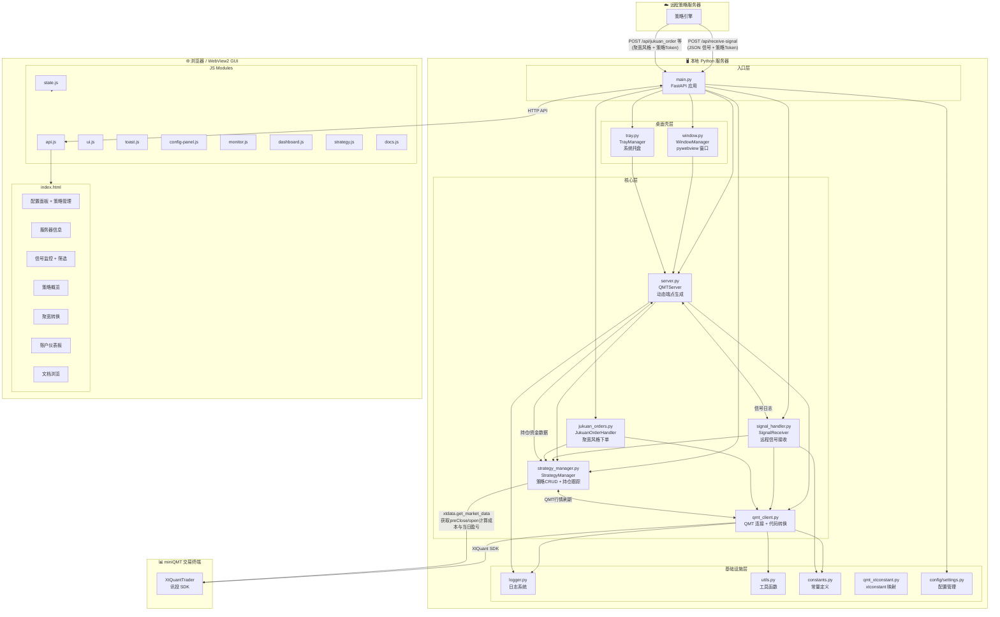
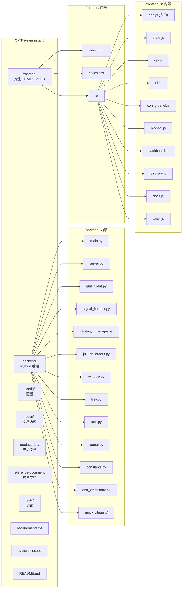
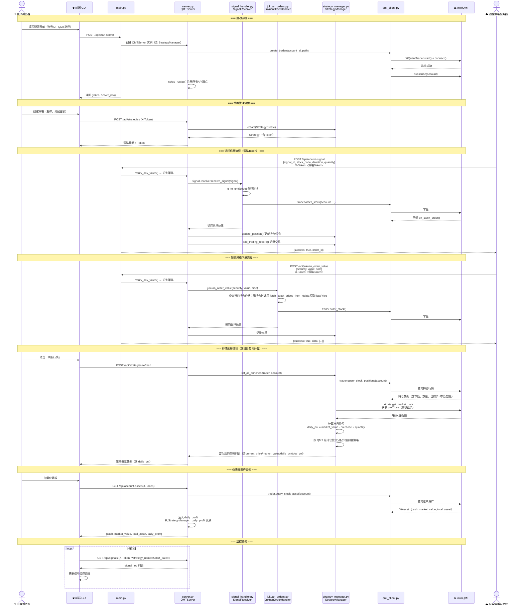
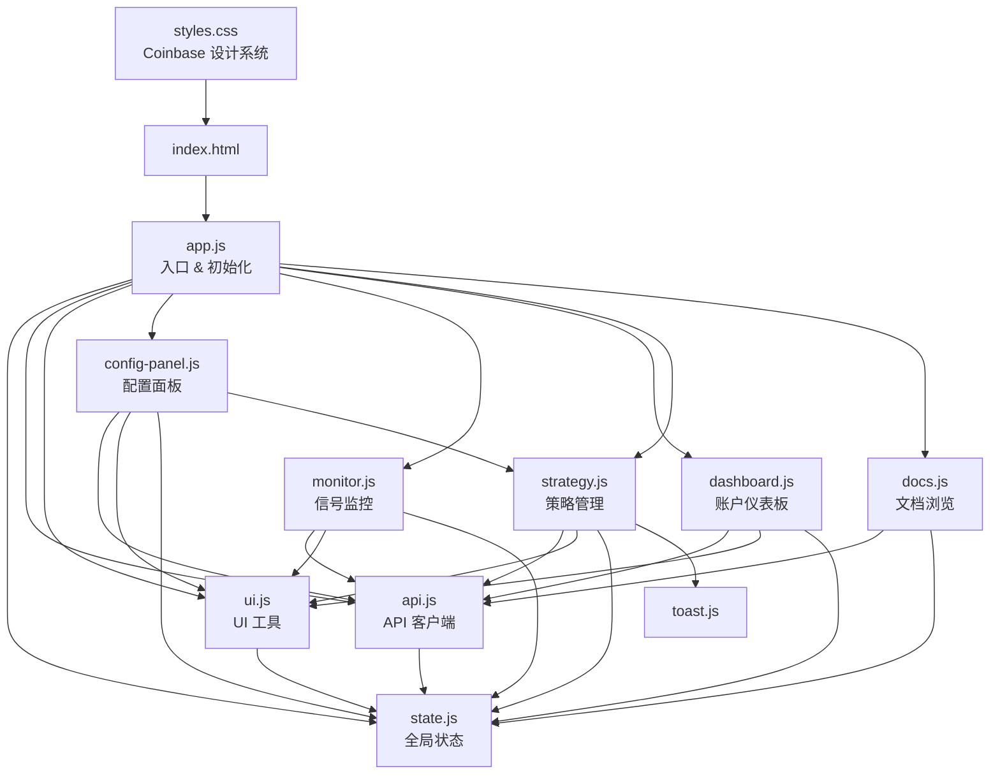
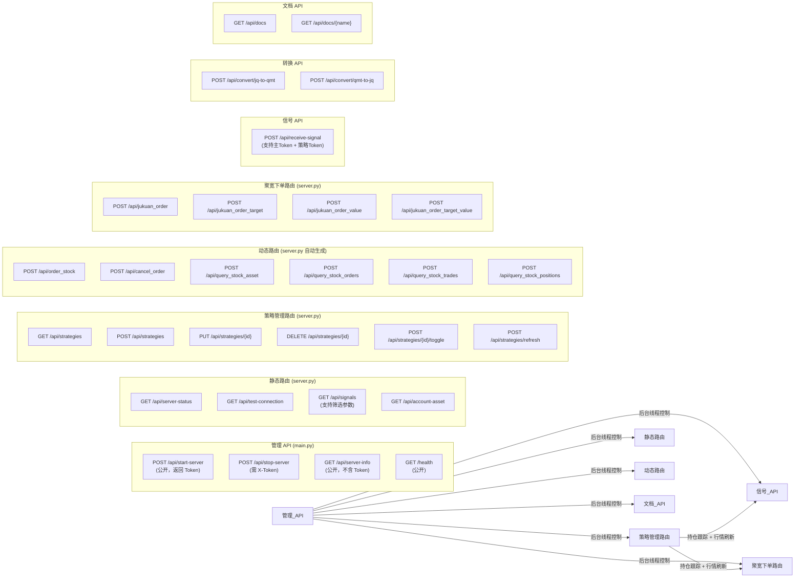

# QMT-live-assistant 实现方案

## Context

根据 PRD.md 需求，构建一个基于 Python 服务器 + 原生 HTML 前端的 miniQMT 量化交易助手。UI 设计采用 DESIGN.md 中定义的 Coinbase 风格。项目 MVP 包括：启动 miniQMT 连接、测试获取可用资金、聚宽代码转换、信号监控。功能升级包括：多策略管理、策略级资金分配与持仓跟踪、策略 Token 认证、信号筛选、聚宽风格下单、桌面窗口模式、系统托盘模式、EXE 打包。

## 技术栈

- **后端**: Python 3.10+ / FastAPI / uvicorn / xtquant SDK
- **前端**: 原生 HTML + CSS + JS（无框架，ES Module）
- **设计**: Coinbase 设计系统（#0052ff 主色，Inter 字体，pill 按钮，24px 卡片圆角）
- **桌面壳**: pywebview（原生 WebView2 窗口）+ pystray（系统托盘）
- **打包**: PyInstaller → 单个 .exe

## 项目架构图示

### 1. 整体系统架构



### 2. 项目目录结构



### 3. 核心数据流



### 4. 前端模块依赖图



### 5. API 路由拓扑



---

## 后端架构

### 1. `config/settings.py` — 配置层
- 从环境变量读取：SERVER_HOST, SERVER_PORT, MINI_QMT_PATH, ACCOUNT_ID, SECRET_KEY, LOG_LEVEL
- 提供合理的默认值
- 导出单例 settings 对象

### 2. `backend/constants.py` — 常量
- ANSI 颜色码（RED, GREEN, YELLOW, BLUE, RESET）
- 订单状态映射（48→未报, 56→已成 等）
- 买卖方向映射

### 3. `backend/logger.py` — 日志
- `create_logger(name)` — 控制台 handler + 按日文件轮转（logs/YYYY-MM-DD.log）
- `WeChatHandler(logging.Handler)` — 企业微信 webhook 推送
- `add_wechat_handler(logger, level, webhook_url)`

### 4. `backend/utils.py` — 工具函数
- `add_stock_suffix(code)` — 6位代码补全后缀（600000→600000.SH）
- `timestamp_to_datetime_string(ts)` — 时间戳转字符串
- `parse_order_type(order_type)` — 订单类型 int→中文
- `convert_to_current_date(ts)` — 将历史时间戳转换为当前日期
- `fetch_preclose_from_xtdata(stock_codes)` — 从 xtdata 获取日线 preClose
- `fetch_open_prices_from_xtdata(stock_codes)` — 从 xtdata 获取日线 open
- `fetch_stock_names_from_xtdata(stock_codes)` — 从 xtdata 获取合约名称
- `fetch_latest_prices_from_xtdata(stock_codes)` — 通过 `xtdata.get_full_tick` 获取最新价（lastPrice），无 xtquant 时 fallback 到 mock 数据
- 以上行情函数统一集中管理，供 `strategy_manager.py`、`server.py`、`jukuan_orders.py` 复用

### 5. `backend/qmt_xtconstant.py` — xtconstant 常量映射
- xtquant 订单类型常量（STOCK_BUY, STOCK_SELL, FIX_PRICE, LATEST_PRICE 等）
- 供 jukuan_orders.py 下单时使用

### 6. `backend/qmt_client.py` — QMT 连接层
- `MyXtQuantTraderCallback(XtQuantTraderCallback)` — 回调处理器
  - `on_disconnected()`, `on_stock_order()`, `on_stock_trade()`, `on_order_error()`, `on_cancel_error()`
  - 将事件追加到共享的 `signal_log` deque 中
- `create_trader(account_id, mini_qmt_path, signal_log)` → `(trader, account, callback)`
  - `session_id = random.randint(100000, 999999)`
  - `xt_trader = XtQuantTrader(path, session_id)`
  - `xt_trader.start()` → `xt_trader.connect()`
  - `account = StockAccount(account_id)`
  - `xt_trader.subscribe(account)`
  - `xt_trader.register_callback(callback)`
  - 非 Windows 平台自动降级到 mock_xtquant
- `jq_to_qmt(code)` / `qmt_to_jq(code)` — 聚宽格式转换
  - XSHE→SZ, XSHG→SH, XBJ→BJ

### 7. `backend/strategy_manager.py` — 策略管理器

`PositionAssignment` Pydantic 模型：
- stock_code, stock_name, quantity（> 0）, current_price（> 0）
- 用于创建/编辑策略时分配账户现有持仓

`Strategy` Pydantic 模型：
- id（自动生成 12 位 hex）、name（必填）、description、enabled
- token（自动生成 32 位 hex，用于远程信号认证）
- allocated_funds（必填，> 0）、available_cash（可用资金）
- total_asset（总资产）、daily_pnl（当日盈亏，从 QMT 行情 + xtdata preClose 计算）
- positions（持久化字段：stock_code, stock_name, quantity, avg_cost；行情字段 current_price/market_value/daily_pnl/total_pnl 由 list_all_enriched 实时计算注入）
- trading_records（买卖记录数组）

`StrategyCreate` 模型：
- name（必填，min_length=1）、description、allocated_funds（必填，> 0）、enabled
- positions（可选 List[PositionAssignment]）— 创建时分配持仓

`StrategyUpdate` 模型：
- 所有字段可选，positions 为 Optional[List[PositionAssignment]]

`StrategyManager` 类：
- CRUD：create, get, list_all, update, delete, toggle
- `create(data)` — 若提供了 positions，通过 `fetch_open_prices_from_xtdata`（来自 `backend.utils`）获取开盘价作为 avg_cost，计算总成本并校验 ≤ allocated_funds，从 available_cash 扣除持仓成本
- `update(id, data)` — 支持 positions 对账；加仓时 avg_cost = (旧成本×旧量 + open_price×增量)/新量，减仓保留原成本，新增取 open_price
- `find_by_token(token)` — 按 Token 查找策略
- `update_position(...)` — 买/卖后更新持仓数量和可用资金
- `add_trading_record(...)` — 添加买卖记录
- `list_all_enriched(trader, account)` → List[dict] — 返回所有策略，并用 QMT 实时行情富化持仓：从 QMT 获取市值/数量 → 按策略占比分配 → 从 xtdata 获取 preClose → 计算 current_price (= 市值/数量)、market_value、daily_pnl (= 市值 - preClose×数量)、total_pnl (= 市值 - avg_cost×数量)；同时计算策略级 total_asset 和 daily_pnl。替代原 refresh_from_qmt+list_all 两步调用
- `daily_profit` property — 返回全局当日盈亏（所有策略汇总）

行情数据获取函数已迁移到 `backend.utils`：
- `fetch_preclose_from_xtdata(stock_codes)` — 调用 `xtdata.download_history_data2` + `get_market_data` 获取日线 preClose 字段，返回 `{stock_code: preClose}`，无 xtquant 时 fallback 到 mock
- `fetch_open_prices_from_xtdata(stock_codes)` — 同上模式获取 `open` 字段，用于 create/update 时设定策略持仓成本价
- `fetch_stock_names_from_xtdata(stock_codes)` — 调用 `xtdata.get_instrument_detail(code)` 获取合约名称
- `fetch_latest_prices_from_xtdata(stock_codes)` — 通过 `xtdata.get_full_tick` 获取 `lastPrice`，用于无持仓时的价值下单

### 8. `backend/server.py` — 核心服务器

`QMTServer` 类：
- `__init__` — 创建 StrategyManager 实例
- `generate_token()` — `secrets.token_hex(32)` 随机生成 64 字符安全 Token
- `verify_token(x_token)` — FastAPI 依赖，校验主 Token
- `verify_any_token(x_token)` — 同时校验主 Token 和所有已启用策略的 Token
- `init_trader()` — 调用 create_trader
- `convert_to_dict(obj)` — 递归转换 XtQuant 对象为 dict
- `setup_routes()` — 注册所有端点：
  - 动态端点（trader 方法自动映射）
  - 策略 CRUD：GET/POST `/api/strategies`、PUT/DELETE `/api/strategies/{id}`、POST toggle、POST refresh
  - 聚宽下单：`/api/jukuan_order`、`/api/jukuan_order_target`、`/api/jukuan_order_value`、`/api/jukuan_order_target_value`
  - `GET /api/signals` — 支持 `start_date`、`end_date`、`strategy_name` 筛选
  - `GET /api/account-asset` — 返回账户资产 + 持仓明细（含 stock_name、open_price、total_pnl 等字段）+ daily_profit
  - `POST /api/receive-signal` — 支持策略 Token，自动关联策略并更新持仓
  - `GET /api/docs`、`GET /api/docs/{name}` — 文档内容
- `init_and_setup()` → `run()` → `stop()`

### 9. `backend/signal_handler.py` — 远程信号接收

`TradeSignal` Pydantic 模型：
- signal_id, stock_code (聚宽格式), direction (buy/sell), quantity, price (可选), order_type, strategy_name, timestamp

`SignalReceiver` 类：
- 接受 `strategy_manager` 参数
- `receive_signal(signal)` → 验证 → 代码转换 → 下单 → 记录日志 → 返回结果

### 10. `backend/jukuan_orders.py` — 聚宽风格下单

`JukuanOrderHandler` 类：
- 实现聚宽 API 风格的下单方法：`jukuan_order`、`jukuan_order_target`、`jukuan_order_value`、`jukuan_order_target_value`
- 支持 security（聚宽格式）自动转换为 QMT 格式下单
- `_get_price(trader, account, jq_code)` — 优先从当前持仓（市值/数量）获取参考价；无持仓时调用 `fetch_latest_prices_from_xtdata` 通过 QMT 全推行情获取 `lastPrice`；均无法获取时抛出异常
- `_get_volume(...)` — 查询当前持仓数量
- 价值下单/目标价值下单时自动获取最新价并计算下单量，按每手股数向下取整
- 期货品种特殊处理：每手为 1，且支持 `side='short'` 反向开平仓
- 将交易记录写入对应的 strategy_manager
- 所有函数/方法已补充中文注释/文档字符串

### 11. `backend/window.py` — pywebview 桌面窗口

`WindowManager` 类：
- 使用 pywebview 创建原生桌面窗口（Windows 上 WebView2，macOS 上 WKWebView）
- 窗口标题、图标、尺寸配置
- 窗口关闭时自动清理服务器资源
- 与 TrayManager 共存

### 12. `backend/tray.py` — 系统托盘

`run_tray_mode(host, port, token, on_exit)` — 便利函数：
- 使用 pystray 创建系统托盘图标
- 右键菜单：打开界面 / 复制 Token / 查看状态 / 退出
- 支持 Windows / macOS / Linux

### 13. `backend/main.py` — 应用入口

- 创建 FastAPI app，配置 CORS 中间件
- 挂载 `../frontend/` 到静态文件
- `GET /` 提供 index.html
- `verify_server_token()` — 全局 Token 校验依赖
- 管理 API：`POST /api/start-server`（返回 Token）、`POST /api/stop-server`（需 X-Token）、`GET /api/server-info`（不含 Token）
- CLI 入口：argparse 支持 --account --qmt-path --host --port --token --tray --window
- 三种运行模式：CLI 模式、系统托盘模式（--tray）、桌面窗口模式（--window）

### 14. `backend/mock_xtquant/__init__.py` — Mock 层

- `MockTrader`: connect(), query_stock_asset() 返回模拟资产数据，query_stock_positions() 返回 3 只模拟持仓（平安银行、贵州茅台、宁德时代）
- `MockPosition`: stock_code, volume, market_value, open_price, can_use_volume, frozen_volume 等
- `MockAsset`: account_id, cash, market_value, total_asset, frozen_cash
- `MockStockAccount`: account_id 属性
- `MockData`: set_qmt_data_dir(), download_history_data2(), get_market_data()（返回 {field: DataFrame}）, get_market_data_ex()（返回 {code: DataFrame}）, get_instrument_detail(), get_full_tick() — 内置 3 只模拟股票（平安银行、贵州茅台、宁德时代）的完整 K 线数据（open/high/low/close/preClose），get_full_tick 返回 lastPrice=close
- `MockTraderCallback`: 基类

---

## 前端架构

### HTML 结构（8 个区域，Coinbase 96px 区块间距）

```
.top-nav              — 固定顶部导航（Logo + 导航链接 + 主题切换）
.main-content
  #account-empty       — 空状态页面（未连接 / 需Token连接）
  #config              — 服务器配置表单（账号ID、QMT路径、主机、端口）
  #server-info         — 服务器状态卡片（状态、Token、连接信息）
  #strategy-management — 策略管理（列表 + 添加/编辑/删除/启用禁用 + Token复制）
  #dashboard           — 账户仪表板（可用资金、持仓市值、总资产、当日盈亏）
  #strategy-overview   — 策略概览（各策略资产卡片 + 点击展开持仓明细表 + 刷新按钮）
  #monitor             — 信号监控面板（筛选栏 + 实时信号列表）
  #converter           — 聚宽代码转换工具
  #docs                — 文档浏览（Markdown 渲染）
.footer                — 页脚
```

### CSS 设计系统（来自 DESIGN.md）
- CSS 自定义属性：颜色、字体、间距、圆角、阴影
- 主色 #0052ff，仅用于主 CTA 和强调
- 按钮：pill 圆角（100px），44px 高度主按钮，带阴影增加立体感
- 卡片：24px 圆角，32px 内边距
- 字体：Inter（正文）、JetBrains Mono（数字）
- 盈亏色值独立于系统状态色值：`--color-pnl-up: #cf202f`（涨红）、`--color-pnl-down: #05b169`（跌绿），系统成功/失败仍用 `--color-semantic-up/down`（绿/红）
- 响应式：1024px / 768px / 480px 断点
- 新增组件样式：策略概览卡片、信号筛选栏、策略列表项、模态框、小按钮、文档区域

### JS 模块设计

**`state.js`** — 全局状态 + Token 持久化
```
serverRunning, token, serverInfo, signals[], theme, pollingInterval
getStoredToken() — 从 sessionStorage 读取 Token
setState('token', v) — 自动同步到 sessionStorage
clearToken() — 清除 sessionStorage 中的 Token
```

**`api.js`** — API 客户端
```
startServer(config), stopServer(), getServerInfo(), testConnection(token),
getSignals(token), getFilteredSignals(token, filters), getAccountAsset(token),
getStrategies(token), createStrategy(data, token), updateStrategy(id, data, token),
deleteStrategy(id, token), toggleStrategy(id, token), refreshStrategies(token),
convertJqToQmt(code), convertQmtToJq(code), healthCheck(),
getDocList(), getDoc(docId)
```

**`ui.js`** — UI 工具
```
updateServerInfo(data), resetServerInfo(), renderSignals(), addSignal(signal),
clearSignals(), updateDashboard(data), disableForm(disable),
toggleTheme(), initTheme(), showConnectPrompt(), hideConnectPrompt(),
showSection(), hideSection(), switchTab(tabName), resetDashboard(),
renderStrategyOverview(strategies), _renderPositionList(),
_renderStrategyPositionList(strategy), _buildPositionRows(positions, opts)
```
- `updateDashboard()` — 渲染仪表板，包含当日盈亏的格式化（正数红色 + 前缀，负数绿色 - 前缀，A 股习惯）；存储持仓数据并通过 `_renderPositionList()` 展示持仓明细表（6列：持仓名+代码、数量/可用、成本/现价、市值、盈亏、当日盈亏）
- `_buildPositionRows()` — 可复用持仓表格行渲染函数，通过 opts 控制是否显示总盈亏列和可用数量列
- `renderStrategyOverview()` — 渲染策略概览卡片（可用资金、总资产、当日盈亏、持仓数、信号数），卡片可点击选中，点击后在下方展示该策略持仓明细表（6列，与账户持仓明细列一致）
- `_renderStrategyPositionList(strategy)` — 将策略持仓数据归一化后调用 `_buildPositionRows()` 渲染；现价使用 API 返回的实时 `current_price`，盈亏数据由后端计算

**`config-panel.js`** — 配置面板
- 表单提交处理（启动/停止服务器）
- 测试连接按钮
- 复制 Token、清空信号、主题切换
- 启动成功后加载策略数据

**`strategy.js`** — 策略管理面板
- `loadStrategies()` — 从 API 加载策略列表并渲染
- `refreshStrategies()` — 调用刷新 API 更新行情数据（含当日盈亏）
- 策略列表渲染：名称、描述、分配金额、可用资金、Token（可复制到剪贴板）、信号计数
- 策略模态框：创建/编辑表单（名称必填、描述、分配金额必填、可选添加持仓）
- `loadAccountPositionsForAssign(strategy)` — 获取账户持仓并渲染分配数量输入框（step=100），计算可用数量（账户总量 - 其他策略已分配量）
- 表单校验：名称不能为空、分配金额必须 > 0、分配数量须为 100 的整数倍且不超过可用数量、持仓总成本不超过分配金额
- 模态框特性：左上角关闭按钮、点击非模态区域不关闭
- 创建成功后展示策略 Token
- `populateStrategyDropdown()` — 填充信号筛选的策略下拉

**`monitor.js`** — 信号监控
- 实时信号列表渲染
- 每 5 秒轮询 `/api/signals`，支持筛选参数
- 筛选栏事件处理：日期选择器 + 策略下拉 + 筛选/重置
- 最多保留 200 条
- 方向颜色：买入绿色、卖出红色

**`dashboard.js`** — 仪表板
- 4 张卡片：可用资金、持仓市值、总资产、当日盈亏
- 点击「持仓市值」或「当日盈亏」卡片展开持仓明细表（6列，含总盈亏和当日盈亏百分比）
- 数字使用 JetBrains Mono 字体
- 连接成功后和连接测试后自动更新

**`docs.js`** — 文档浏览
- 加载文档列表和文档内容
- Markdown 渲染（h1-h6, code, table, link 等）

**`toast.js`** — Toast 通知
- `Toast.success()`, `Toast.error()`, `Toast.warning()`, `Toast.info()`
- 自动消失、堆叠显示

---

## 实现顺序

### Phase 1: 项目基础搭建 ✅
1. 创建目录结构
2. `requirements.txt`（fastapi, uvicorn, pydantic, xtquant, pytest, pytest-asyncio, httpx）
3. `config/settings.py`

### Phase 2: 后端核心 ✅
4. `backend/constants.py`
5. `backend/utils.py`
6. `backend/logger.py`
7. `backend/qmt_client.py`
8. `backend/mock_xtquant/__init__.py`
9. `backend/server.py`

### Phase 3: 后端信号功能 ✅
10. `backend/signal_handler.py`
11. `backend/main.py`

### Phase 4: 后端策略管理 ✅
12. `backend/strategy_manager.py` — 策略模型 + CRUD + 持仓跟踪 + QMT 行情刷新 + xtdata 当日盈亏计算
13. `server.py` — 集成 StrategyManager、策略 API、verify_any_token
14. `signal_handler.py` — 接入 strategy_manager

### Phase 5: 后端测试 ✅
15. `tests/test_client.py`
16. `tests/test_server.py`
17. `tests/test_signal_handler.py`
18. `tests/test_strategy_manager.py`
19. `tests/test_jukuan_orders.py`
20. `tests/test_utils.py`

### Phase 6: 前端 ✅
18. `frontend/styles.css`（含策略概览、筛选栏、模态框等新组件样式）
19. `frontend/index.html`（含策略概览区、策略管理区、筛选栏、模态框、文档区）
20. `frontend/js/state.js` → `api.js` → `ui.js` → `toast.js`
21. `frontend/js/config-panel.js` → `monitor.js` → `dashboard.js` → `strategy.js`
22. `frontend/js/docs.js`
23. `frontend/js/app.js`

### Phase 7: 聚宽风格下单 ✅
24. `backend/qmt_xtconstant.py` — xtconstant 常量映射
25. `backend/jukuan_orders.py` — 聚宽风格下单处理器
26. `server.py` — 注册 jukuan 下单端点

### Phase 8: 桌面壳 ✅
27. `backend/tray.py` — 系统托盘模式
28. `backend/window.py` — pywebview 桌面窗口模式
29. `main.py` — 集成 --tray / --window CLI 参数

### Phase 9: EXE 打包 ✅
30. `pyinstaller.spec` — PyInstaller 打包配置
31. 打包输出单个 .exe，双击即用

### Phase 10: 集成与文档 ✅
32. 集成测试验证
33. `README.md`
34. `IMPLEMENTATION_PLAN.md`

### Phase 11: 行情工具重构与无持仓取价 ✅
35. 将 `strategy_manager.py` 中的 `_fetch_preclose_from_xtdata`、`_fetch_open_prices_from_xtdata`、`_fetch_stock_names_from_xtdata` 迁移到 `backend/utils.py`，并改名为公共函数
36. 在 `backend/utils.py` 新增 `fetch_latest_prices_from_xtdata`，通过 `xtdata.get_full_tick` 获取最新价 `lastPrice`
37. 修改 `backend/jukuan_orders.py` 的 `_get_price`，无持仓时调用 `fetch_latest_prices_from_xtdata` 获取行情价，支持首次价值建仓
38. 扩展 `backend/mock_xtquant/MockData` 支持 `get_full_tick`
39. 补充 `tests/test_utils.py` 和 `tests/test_jukuan_orders.py` 相关测试
40. 更新 `README.md` 与 `IMPLEMENTATION_PLAN.md`

---

## 验证方案

1. **后端测试**：`pytest tests/ -v` 验证所有单元测试通过
2. **Mock 模式启动**：在 macOS 上 `python -m backend.main` 验证服务器启动成功
3. **前端验证**：浏览器打开 `http://localhost:8000`，验证 UI 渲染和 API 交互
4. **仪表板当日盈亏**：连接服务器后验证仪表板"当日盈亏"卡片正确显示数值和颜色（正数红色、负数绿色，A 股习惯）
5. **策略管理**：创建策略（名称和分配金额必填，可选分配账户持仓）→ 获取 Token → 点击策略概览卡片查看持仓明细 → 编辑/删除策略
6. **行情刷新**：点击刷新按钮 → 验证 xtdata 获取 preClose 并正确计算当日盈亏
7. **信号测试**：用策略 Token 发送信号 → 验证策略持仓和资金自动更新
8. **聚宽下单**：用策略 Token 调用聚宽风格下单 API → 验证自动下单和持仓更新
9. **聚宽价值下单无持仓场景**：对当前无持仓的股票调用 `/api/jukuan_order_value` → 验证通过 `get_full_tick` 获取最新价并成功计算下单数量
10. **信号筛选**：按日期和策略筛选信号 → 验证筛选结果
11. **代码转换**：验证 jq_to_qmt 和 qmt_to_jq 转换正确性
12. **桌面窗口模式**：`--window` 参数启动 → 验证 pywebview 原生窗口 + 系统托盘
13. **系统托盘模式**：`--tray` 参数启动 → 验证托盘菜单功能
14. **EXE 打包**：PyInstaller 打包 → 双击 .exe 验证完整功能
