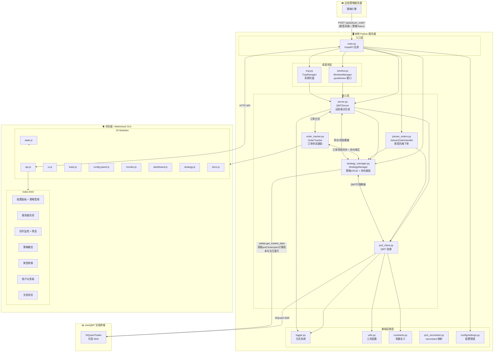
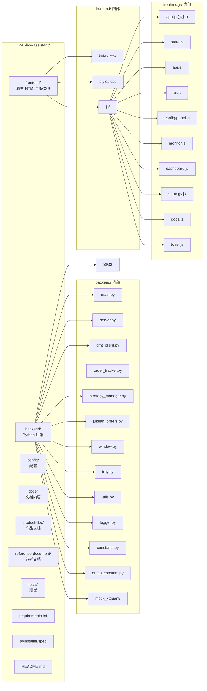
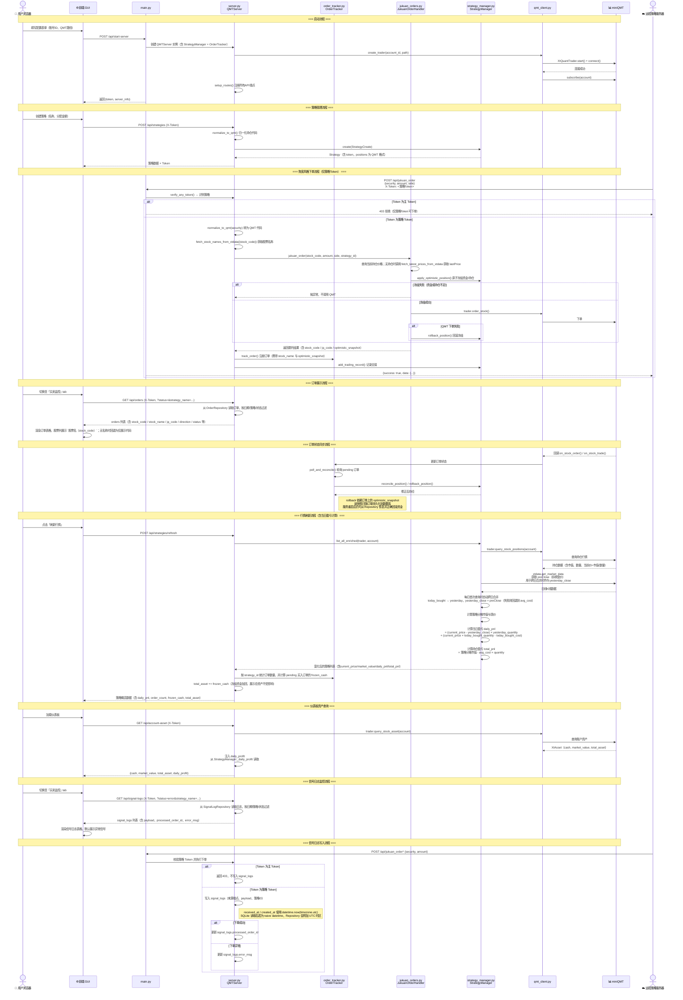
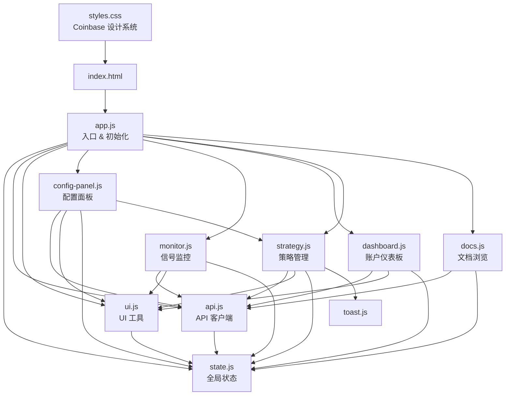
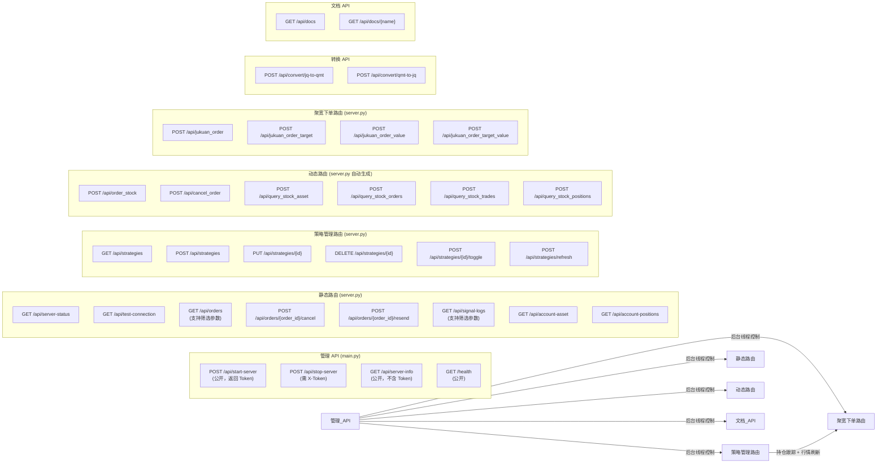

# QMT-live-assistant 实现方案

## Context

根据 PRD.md 需求，构建一个基于 Python 服务器 + 原生 HTML 前端的 miniQMT 量化交易助手。UI 设计采用 DESIGN.md 中定义的 Coinbase 风格。项目 MVP 包括：启动 miniQMT 连接、测试获取可用资金、聚宽代码转换、信号监控。功能升级包括：多策略管理、策略级资金分配与持仓跟踪、策略 Token 认证、信号筛选、聚宽风格下单、桌面窗口模式、系统托盘模式、EXE 打包。

## 技术栈

- **后端**: Python 3.10+ / FastAPI / uvicorn / xtquant SDK
- **前端**: 原生 HTML + CSS + JS（无框架，ES Module）
- **设计**: Coinbase 设计系统（#0052ff 主色，Inter 字体，pill 按钮，24px 卡片圆角）
- **桌面壳**: pywebview（原生 WebView2 窗口）+ pystray（系统托盘）
- **打包**: PyInstaller → 单个 .exe

## 项目架构图示

### 1. 整体系统架构



### 2. 项目目录结构



### 3. 核心数据流



### 4. 前端模块依赖图



### 5. API 路由拓扑



---

## 后端架构

### 1. `config/settings.py` — 配置层
- 从环境变量读取：SERVER_HOST, SERVER_PORT, MINI_QMT_PATH, ACCOUNT_ID, SECRET_KEY, LOG_LEVEL
- 提供合理的默认值
- 导出单例 settings 对象

### 2. `backend/constants.py` — 常量
- ANSI 颜色码（RED, GREEN, YELLOW, BLUE, RESET）
- 订单状态映射（48→未报, 56→已成 等）
- 买卖方向映射

### 3. `backend/logger.py` — 日志
- `create_logger(name)` — 控制台 handler + 按日文件轮转（logs/YYYY-MM-DD.log）
- `WeChatHandler(logging.Handler)` — 企业微信 webhook 推送
- `add_wechat_handler(logger, level, webhook_url)`

### 4. `backend/utils.py` — 工具函数
- `add_stock_suffix(code)` — 6位代码补全后缀（600000→600000.SH）
- `timestamp_to_datetime_string(ts)` — 时间戳转字符串
- `parse_order_type(order_type)` — 订单类型 int→中文
- `convert_to_current_date(ts)` — 将历史时间戳转换为当前日期
- `jq_to_qmt(code)` / `qmt_to_jq(code)` — 聚宽格式与 QMT 格式代码互转（XSHE↔SZ、XSHG↔SH、XBJ↔BJ）
- `normalize_to_qmt(code)` — 在系统边界将聚宽/QMT/其他格式统一归一化为 QMT 格式（.SZ/.SH/.BJ）
- `fetch_preclose_from_xtdata(stock_codes)` — 从 xtdata 获取日线 preClose
- `fetch_open_prices_from_xtdata(stock_codes)` — 从 xtdata 获取日线 open
- `fetch_stock_names_from_xtdata(stock_codes)` — 从 xtdata 获取合约名称
- `fetch_latest_prices_from_xtdata(stock_codes)` — 通过 `xtdata.get_full_tick` 获取最新价（lastPrice），无 xtquant 时 fallback 到 mock 数据
- `seconds_until_market_open(target_hour, target_minute)` — 计算到下一个市场开盘时刻（默认 09:30）的秒数，用于启动每日开盘主动轮询任务
- 以上行情函数与代码转换函数统一集中管理，供 `order_tracker.py`、`strategy_manager.py`、`server.py`、`jukuan_orders.py` 复用

### 5. `backend/qmt_xtconstant.py` — xtconstant 常量映射
- xtquant 订单类型常量（STOCK_BUY, STOCK_SELL, FIX_PRICE, LATEST_PRICE 等）
- 供 jukuan_orders.py 下单时使用

### 6. `backend/qmt_client.py` — QMT 连接层
- `MyXtQuantTraderCallback(XtQuantTraderCallback)` — 回调处理器
  - `on_disconnected()`, `on_stock_order()`, `on_stock_trade()`, `on_order_error()`, `on_cancel_error()`
  - 将订单/成交事件同步到 `OrderTracker`
- `create_trader(account_id, mini_qmt_path, callback)` → `(trader, account, callback)`
  - `session_id = random.randint(100000, 999999)`
  - `xt_trader = XtQuantTrader(path, session_id)`
  - `xt_trader.start()` → `xt_trader.connect()`
  - `account = StockAccount(account_id)`
  - `xt_trader.subscribe(account)`
  - `xt_trader.register_callback(callback)`
  - 非 Windows 平台自动降级到 mock_xtquant

### 6.5 `backend/connection_watchdog.py` — QMT 连接看门狗
- `ConnectionState` 枚举：DISCONNECTED / CONNECTING / CONNECTED / RECONNECTING / FAILED
- `_ReconnectAwareCallback` — 扩展 `MyXtQuantTraderCallback`，QMT 回调 `on_disconnected` 时通过 `loop.call_soon_threadsafe()` 通知看门狗
- `QMTConnectionWatchdog` 类：
  - `start()` / `stop()` 生命周期管理
  - `_watchdog_loop()` — 连接、等待断线信号或健康检查、自动重连
  - `_attempt_connect()` — 在 `asyncio.Lock` 保护下创建 trader，连接成功后执行健康检查
  - `_health_check()` — 通过 `query_stock_asset` 验证连接可用性
  - `_backoff_sleep()` — 指数退避（上限可配置）+ 20% 抖动
  - `request_reconnect()` — 线程安全地请求重连
- 由 `QMTServer` 持有并管理，断线期间 `qmt_connected` 为 false，交易/账户接口返回 503

### 7. `backend/strategy_manager.py` — 策略管理器

`PositionAssignment` Pydantic 模型：
- stock_code, stock_name, quantity（> 0）, current_price（> 0）
- 用于创建/编辑策略时分配账户现有持仓

`Strategy` Pydantic 模型（位于 `backend/models/strategy.py`）：
- id（自动生成 12 位 hex）、name（必填）、description、enabled
- token（自动生成 32 位 hex，用于远程聚宽风格下单认证）
- allocated_funds（必填，> 0）、available_cash（可用资金）
- total_asset（总资产）、daily_pnl（当日盈亏，由 list_all_enriched 根据昨日持仓和今日买入拆分计算后注入）
- positions（持久化字段：stock_code 统一为 QMT 格式，stock_name, quantity, available_quantity, frozen_quantity, avg_cost, yesterday_quantity, yesterday_close, today_bought_quantity, today_bought_cost；行情字段 current_price/market_value/daily_pnl/total_pnl 由 list_all_enriched 实时计算注入）
- last_rollover_date（上次跨日合并日期，格式 YYYYMMDD，用于每日首次查询时自动合并 today_bought → yesterday）
- trading_records（买卖记录数组）
- deleted_at（软删除标记，None 表示未删除）

`StrategyCreate` 模型：
- name（必填，min_length=1）、description、allocated_funds（必填，> 0）、enabled
- positions（可选 List[PositionAssignment]）— 创建时分配持仓

`StrategyUpdate` 模型：
- 所有字段可选，positions 为 Optional[List[PositionAssignment]]

`StrategyManager` 类：
- 通过构造函数注入 `StrategyRepository`，未传入时自动降级为 `InMemoryStrategyRepository`
- 内部维护 `_strategies` 内存缓存，通过 `_refresh_cache()` 从 Repository 加载，兼容现有测试与无持久化场景
- CRUD：create, get, list_all, update, delete（SQLAlchemy 实现为软删除，设置 `deleted_at`）, toggle
- 所有写操作通过 `model_copy(deep=True, update=...)` 生成新的 `Strategy` 对象，保持领域模型不可变
- `create(data)` — 若提供了 positions，通过 `fetch_open_prices_from_xtdata`（来自 `backend.utils`）获取开盘价作为 avg_cost，计算总成本并校验 ≤ allocated_funds，从 available_cash 扣除持仓成本
- `update(id, data)` — 支持 positions 对账；加仓时 avg_cost = (旧成本×旧量 + open_price×增量)/新量，减仓保留原成本，新增取 open_price
- `find_by_token(token)` — 通过 Repository 按 Token 查找策略
- `get_position(strategy_id, stock_code)` / `get_quantity(...)` / `get_available_quantity(...)` / `get_available_cash(...)` — 策略级只读查询，供 `JukuanOrderHandler` 在 strategy token 下单时做计算与校验
- `update_position(...)` — 按实际成交更新持仓数量、可用数量与可用资金
- `apply_optimistic_position(...)` — 下单时按买入/卖出分别处理：买入仅冻结资金，不创建/修改 position 行；卖出校验策略可用持仓充足后减少 available_quantity、增加 frozen_quantity，并增加预期资金。返回增量快照用于回滚/修正
- `rollback_position(...)` — 订单失败或撤单时根据快照解冻持仓
- `reconcile_position(...)` — 实际成交与委托不一致时，先回滚到快照再按真实成交修正持仓
- `add_trading_record(...)` — 添加买卖记录
- `list_all_enriched(trader, account)` → List[dict] — 返回所有策略，并用 QMT 实时行情富化持仓：从 QMT 获取账户持仓市值/数量 → 按策略持仓数量占账户总持仓比例分配市值 → 每日首次调用时检测 `last_rollover_date`，跨日自动将 `today_bought_quantity` 合并到 `yesterday_quantity` 并以昨日收盘价作为 `yesterday_close`；计算 `current_price` (= 市值/数量)、`market_value`（策略分摊市值）；`daily_pnl` 拆分为「昨日持仓部分：current_price×yesterday_quantity − yesterday_close×yesterday_quantity」+「今日买入部分：current_price×today_bought_quantity − today_bought_cost」；`total_pnl` = 策略分摊市值 − avg_cost×quantity；同时计算策略级 total_asset 和 daily_pnl。替代原 refresh_from_qmt+list_all 两步调用
- `daily_profit` property — 返回全局当日盈亏（所有策略汇总）
- 策略持仓统一以 QMT 格式（.SZ/.SH/.BJ）持久化，不再维护独立的信号计数

行情数据获取函数已迁移到 `backend.utils`：
- `fetch_preclose_from_xtdata(stock_codes)` — 调用 `xtdata.download_history_data2` + `get_market_data` 获取日线 preClose 字段，返回 `{stock_code: preClose}`，无 xtquant 时 fallback 到 mock
- `fetch_open_prices_from_xtdata(stock_codes)` — 同上模式获取 `open` 字段，用于 create/update 时设定策略持仓成本价
- `fetch_stock_names_from_xtdata(stock_codes)` — 调用 `xtdata.get_instrument_detail(code)` 获取合约名称
- `fetch_latest_prices_from_xtdata(stock_codes)` — 通过 `xtdata.get_full_tick` 获取 `lastPrice`，用于无持仓时的价值下单

### 8. `backend/server.py` — 核心服务器

`QMTServer` 类：
- `__init__` — 接收 `strategy_repository` / `order_repository` / `account_repository` / `signal_log_repository` / `db_session`，创建 `StrategyManager` 与 `OrderTracker` 实例；未传入 Repository 时自动使用 InMemory 实现；初始化 `QMTConnectionWatchdog` 通过 `init_trader_async()` 管理
- `generate_token()` — `secrets.token_hex(32)` 随机生成 64 字符安全 Token
- `verify_token(x_token)` — FastAPI 依赖，校验主 Token
- `verify_any_token(x_token)` — 同时校验主 Token 和所有已启用策略的 Token
- `init_trader_async()` — 初始化并启动 QMT 连接看门狗
- `_ensure_account_record()` — 启用数据库时，启动前同步当前账户信息到 `accounts` 表
- `convert_to_dict(obj)` — 递归转换 XtQuant 对象为 dict
- `_track_and_apply_order(...)` — 将聚宽下单结果注册到 OrderTracker，返回跟踪订单对象；乐观冻结已在 `JukuanOrderHandler._submit_order` 中完成，本方法仅将 `optimistic_snapshot` 随订单一起持久化，用于后续 reconcile / rollback
- `_poll_orders_loop()` — 每 5 秒轮询 pending/partial 订单状态
- `_market_open_poll_loop()` — 每日 09:30 自动执行一次 `poll_and_reconcile`，刷新隔夜 pending 订单状态
- `setup_routes()` — 注册所有端点：
  - 动态端点（trader 方法自动映射）
  - 策略 CRUD：GET/POST `/api/strategies`、PUT/DELETE `/api/strategies/{id}`、POST toggle、POST refresh
  - 聚宽下单：`/api/jukuan_order`、`/api/jukuan_order_target`、`/api/jukuan_order_value`、`/api/jukuan_order_target_value`（仅接受策略 Token，主 Token 返回 403）
  - `GET /api/orders` — 支持 `status`、`strategy_name`、`start_date`、`end_date` 筛选，返回新增 `retried_as_order_id` 字段
  - `POST /api/orders/{order_id}/cancel` — 撤销 pending/partial 订单
  - `POST /api/orders/{order_id}/resend` — 重发 failed 订单
  - `GET /api/account-asset` — 返回账户资产 + 持仓明细（含 stock_name、open_price、total_pnl 等字段）+ daily_profit
  - `GET /api/account-positions` — 返回账户持仓明细
  - `POST /api/convert/jq-to-qmt`、`POST /api/convert/qmt-to-jq` — 代码转换
  - `GET /api/docs`、`GET /api/docs/{name}` — 文档内容
- 在 `/api/strategies` 和 `/api/strategies/refresh` 返回前，从 OrderTracker 统计每个策略的订单数量并注入 `order_count`；同时计算 pending/partial 买入订单的 `frozen_cash` 并注入，且把 `frozen_cash` 加回到 `total_asset`，使接口返回的策略总资产不受未成交订单影响
- 创建/更新策略时通过 `normalize_to_qmt()` 将持仓 stock_code 统一为 QMT 格式
- 聚宽下单端点写入 `signal_logs`，记录来源平台、请求 payload、处理后订单 ID 及异常信息
- `_require_qmt_connected` 依赖在 QMT 未连接时返回 503，保护交易与账户接口
- `init_and_setup()` / `init_and_setup_async()` / `stop()` / `stop_async()` 生命周期管理，停止时取消轮询任务并关闭看门狗与数据库 Session

### 9. `backend/order_tracker.py` — 订单状态跟踪

`TrackedOrder` / `OrderState` 已迁移至 `backend/models/order.py`：
- order_id, stock_code（QMT 格式）, jq_code（聚宽格式）, direction, quantity, filled_quantity, filled_price
- status（pending / partial / filled / failed）, order_type, strategy_id, strategy_name
- placed_at, resolved_at, error_msg, optimistic_position_applied, optimistic_snapshot

`OrderModel` 与 `OrderRepository` 已同步持久化 `optimistic_position_applied` 和 `optimistic_snapshot`，确保服务重启后从数据库加载的 pending 订单仍保留回滚所需快照，订单失败时能够正确恢复策略资金。

`OrderTracker` 类：
- 通过构造函数注入 `OrderRepository`，未传入时自动降级为 `InMemoryOrderRepository`
- 启动时调用 `_load_orders()` 从 Repository 恢复 pending 订单到内存状态机
- `track_order(...)` — 注册一笔新订单，同时持久化并记录 `placed` 事件
- `get_order(order_id)` / `get_orders_by_strategy(strategy_id)` / `list_all()` — 按订单 ID、策略 ID 查询或列出全部
- `update_order(order_id, **kwargs)` — 更新订单字段
- `on_state_change(callback)` — 注册订单状态变更回调
- `poll_and_reconcile(trader, account)` — 后台轮询 pending 订单，根据 QMT 实际成交修正策略持仓
- `cancel_order(trader, account, order_id)` — 手动撤销 pending/partial 订单，调用 QMT `cancel_order` 后将本地订单置为 failed 并触发持仓回滚
- 订单达到终态（filled / failed）时触发回调，调用 StrategyManager 的 `reconcile_position` 或 `rollback_position`
- 每次状态变更通过 `_persist()` 保存订单并写入 `order_events` 审计事件

### 10. `backend/jukuan_orders.py` — 聚宽风格下单

`JukuanOrderHandler` 类：
- 实现聚宽 API 风格的下单方法：`jukuan_order`、`jukuan_order_target`、`jukuan_order_value`、`jukuan_order_target_value`
- 所有方法接收 QMT 格式代码（`stock_code`），内部通过 `qmt_to_jq()` 在订单备注中保留原始聚宽代码
- 当调用方传入 `strategy_id` 时，下单数量与校验优先基于**策略级**数据：
  - `_get_price(..., strategy_manager, strategy_id)` — 优先读取策略持仓 `avg_cost`；无策略或策略无持仓时，fallback 到账户持仓市值/行情价
  - `_get_volume(..., strategy_manager, strategy_id)` — 优先返回策略持仓 `quantity`；无策略时返回账户持仓数量
  - `jukuan_order_target` 的 `当前持仓` 使用策略持仓
  - `jukuan_order_value` / `jukuan_order_target_value` 的当前市值、可买数量使用策略数据，且买入金额受 `strategy.available_cash` 限制
- `_submit_order` 对策略 token 订单执行**原子校验与冻结**：
  - 在调用 `trader.order_stock()` 之前，先调用 `strategy_manager.apply_optimistic_position()` 冻结资金/持仓
  - 冻结失败（资金或持仓不足）时直接抛异常，订单不会发往 QMT
  - QMT 下单失败（抛异常或返回空 order_id）时，立即调用 `rollback_position()` 回滚已冻结资金/持仓
  - 返回结果包含 `stock_code`（QMT）、`jq_code`（聚宽）以及 `optimistic_snapshot`，便于上层 OrderTracker 记录、回滚与展示
- 期货品种特殊处理：每手为 1，且支持 `side='short'` 反向开平仓
- 返回结果包含 `stock_code`（QMT）和 `jq_code`（聚宽）双格式，便于上层 OrderTracker 记录与展示
- 所有函数/方法已补充中文注释/文档字符串

### 11. `backend/window.py` — pywebview 桌面窗口

`WindowManager` 类：
- 使用 pywebview 创建原生桌面窗口（Windows 上 WebView2，macOS 上 WKWebView）
- 窗口标题、图标、尺寸配置
- 窗口关闭时自动清理服务器资源
- 与 TrayManager 共存

### 12. `backend/tray.py` — 系统托盘

`run_tray_mode(host, port, token, on_exit)` — 便利函数：
- 使用 pystray 创建系统托盘图标
- 右键菜单：打开界面 / 复制 Token / 查看状态 / 退出
- 支持 Windows / macOS / Linux

### 13. `backend/main.py` — 应用入口

- 创建 FastAPI app，配置 CORS 中间件
- 挂载 `../frontend/` 到静态文件
- `GET /` 提供 index.html
- `verify_server_token()` — 全局 Token 校验依赖
- 根据 `PERSISTENCE_MODE` 创建 SQLAlchemy Session 与 Repository（`sqlite` 模式）或 InMemory Repository（`memory` 模式）
- 管理 API：`POST /api/start-server`（返回 Token）、`POST /api/stop-server`（需 X-Token）、`GET /api/server-info`（不含 Token）
- CLI 入口：argparse 支持 --account --qmt-path --host --port --token --tray --window
- 三种运行模式：CLI 模式、系统托盘模式（--tray）、桌面窗口模式（--window）

### 14. `backend/mock_xtquant/__init__.py` — Mock 层

- `MockTrader`: connect(), query_stock_asset() 返回模拟资产数据，query_stock_positions() 返回 3 只模拟持仓（平安银行、贵州茅台、宁德时代）
- `MockPosition`: stock_code, volume, market_value, open_price, can_use_volume, frozen_volume 等
- `MockAsset`: account_id, cash, market_value, total_asset, frozen_cash
- `MockStockAccount`: account_id 属性
- `MockData`: set_qmt_data_dir(), download_history_data2(), get_market_data()（返回 {field: DataFrame}）, get_market_data_ex()（返回 {code: DataFrame}）, get_instrument_detail(), get_full_tick() — 内置 3 只模拟股票（平安银行、贵州茅台、宁德时代）的完整 K 线数据（open/high/low/close/preClose），get_full_tick 返回 lastPrice=close
- `MockTraderCallback`: 基类

### 15. `backend/db/` — 数据库层

- `backend/db/base.py` — SQLAlchemy `Base` 与 `SessionLocal`，读取 `DATABASE_URL`
- `backend/db/models/` — 7 张表的数据库模型：`AccountModel`、`StrategyModel`、`PositionModel`、`OrderModel`、`StrategyTokenModel`、`OrderEventModel`、`SignalLogModel`
- `backend/db/repositories/` — Repository 抽象基类 `Repository` / `InMemoryRepository`，以及 `StrategyRepository`、`OrderRepository`、`AccountRepository`、`SignalLogRepository` 的 SQLAlchemy + InMemory 双实现
- `backend/db/migrations/` — Alembic 迁移脚本，当前包含初始化表结构与存储完整策略 Token 的两条迁移

### 16. `backend/models/` — 领域模型

- `backend/models/strategy.py` — Pydantic 领域模型：`Strategy`、`PositionAssignment`、`StrategyCreate`、`StrategyUpdate`
- `backend/models/order.py` — `TrackedOrder`（Pydantic）与 `OrderState` 状态常量
- 将业务层与数据库层解耦，Repository 负责领域模型与数据库模型之间的映射转换

---

## 前端架构

### HTML 结构（8 个区域，Coinbase 96px 区块间距）

```
.top-nav              — 固定顶部导航（Logo + 导航链接 + 主题切换）
.main-content
  #account-empty       — 空状态页面（未连接 / 需Token连接）
  #config              — 服务器配置表单（账号ID、QMT路径、主机、端口）
  #server-info         — 服务器状态卡片（状态、Token、连接信息）
  #strategy-management — 策略管理（列表 + 添加/编辑/删除/启用禁用 + Token复制）
  #dashboard           — 账户仪表板（可用资金、持仓市值、总资产、当日盈亏）
  #strategy-overview   — 策略概览（各策略资产卡片 + 点击展开持仓明细表 + 刷新按钮）
  #monitor             — 订单监控面板（日期/策略/状态筛选栏 + 实时订单列表 + 列表底部条数统计）
  #converter           — 聚宽代码转换工具
  #docs                — 文档浏览（Markdown 渲染）
.footer                — 页脚
```

### CSS 设计系统（来自 DESIGN.md）
- CSS 自定义属性：颜色、字体、间距、圆角、阴影
- 主色 #0052ff，仅用于主 CTA 和强调
- 按钮：pill 圆角（100px），44px 高度主按钮，带阴影增加立体感
- 卡片：24px 圆角，32px 内边距
- 字体：Inter（正文）、JetBrains Mono（数字）
- 盈亏色值独立于系统状态色值：`--color-pnl-up: #cf202f`（涨红）、`--color-pnl-down: #05b169`（跌绿），系统成功/失败仍用 `--color-semantic-up/down`（绿/红）
- 响应式：1024px / 768px / 480px 断点
- 新增组件样式：策略概览卡片、订单筛选栏、策略列表项、模态框、小按钮、文档区域

### JS 模块设计

**`state.js`** — 全局状态 + Token 持久化
```
serverRunning, token, serverInfo, orders[], theme, pollingInterval
qmtConnected, connectionState, lastConnectionError
getStoredToken() — 从 sessionStorage 读取 Token
setState('token', v) — 自动同步到 sessionStorage
clearToken() — 清除 sessionStorage 中的 Token
```

**`api.js`** — API 客户端
```
startServer(config), stopServer(), getServerInfo(), testConnection(token),
getOrders(token, filters), getAccountAsset(token), getAccountPositions(token),
getStrategies(token), createStrategy(data, token), updateStrategy(id, data, token),
deleteStrategy(id, token), toggleStrategy(id, token), refreshStrategies(token),
convertJqToQmt(code), convertQmtToJq(code), healthCheck(),
getDocList(), getDoc(docId),
cancelOrder(orderId, token), resendOrder(orderId, token)
```

**`ui.js`** — UI 工具
```
updateServerInfo(data), resetServerInfo(), renderOrders(), addOrder(order),
clearOrders(), updateDashboard(data), disableForm(disable),
toggleTheme(), initTheme(), showConnectPrompt(), hideConnectPrompt(),
showSection(), hideSection(), switchTab(tabName), resetDashboard(),
renderStrategyOverview(strategies), setOrderFilterHandler(handler),
_renderPositionList(), _renderStrategyPositionList(strategy), _buildPositionRows(positions, opts),
_isConfigFormComplete(), _setConfigButtonStates(serverRunning), updateConfigButtons(),
_updateLogoStatus(statusClass), showReconnectingBanner(message), hideReconnectingBanner()
```
- `setOrderFilterHandler(handler)` — 注册策略订单数量被点击时的回调，回调接收 strategy_name，由 `app.js` 转发到 `applyOrderFilters` 实现跳转
- `updateDashboard()` — 渲染仪表板，包含当日盈亏的格式化（正数红色 + 前缀，负数绿色 - 前缀，A 股习惯）；存储持仓数据并通过 `_renderPositionList()` 展示持仓明细表（6列：持仓名+代码、数量/可用、成本/现价、市值、盈亏、当日盈亏）
- `_buildPositionRows()` — 可复用持仓表格行渲染函数，通过 opts 控制是否显示总盈亏列和可用数量列
- `renderStrategyOverview()` — 渲染策略概览卡片（可用资金、总资产、当日盈亏、持仓数、订单数），卡片可点击选中，点击后先展示 loading，再调用 API 加载并在下方展示该策略持仓明细表（6列，与账户持仓明细列一致）；订单数量可点击，点击后触发订单筛选跳转
- `_renderStrategyPositionList(strategy)` — 将策略持仓数据归一化后调用 `_buildPositionRows()` 渲染；现价使用 API 返回的实时 `current_price`，盈亏数据由后端计算
- `_showStrategyPositionLoading()` / `_renderStrategyPositionLoadError()` — 策略卡片点击后展示/取消 loading 与错误提示
- `_showAccountPositionLoading()` / `_renderAccountPositionLoadError()` — 账户持仓市值/当日盈亏卡片点击后展示/取消 loading 与错误提示
- `_updateLogoStatus(statusClass)` — 根据连接状态更新页面顶部 Logo 前圆点颜色（connected / reconnecting / disconnected / failed）
- `showReconnectingBanner(message)` / `hideReconnectingBanner()` — 在顶部导航下方展示/隐藏 QMT 重连提示横幅
- `renderOrders()` — 渲染订单列表，表头增加「操作」列；`pending`/`partial` 行显示「撤销」按钮，`failed` 且未重发过的行显示「重发」按钮；点击按钮由 `monitor.js` 事件委托处理

**`config-panel.js`** — 配置面板
- 表单提交处理（启动/停止服务器）
- 测试连接按钮
- 复制 Token、清空订单、主题切换
- 启动成功后加载策略数据
- 表单完整性实时校验：监听 `#config-form` 所有 `input` 的 `input` 事件，调用 `UI.updateConfigButtons()`；当账号 ID、miniQMT 路径、服务器地址、端口任一必填项为空时，「启动服务器」与「停止服务器」按钮均禁用

**`strategy.js`** — 策略管理面板
- `loadStrategies()` — 从 API 加载策略列表并渲染
- `refreshStrategies()` — 调用刷新 API 更新行情数据（含当日盈亏）
- 策略列表渲染：名称、描述、分配金额、可用资金、Token（可复制到剪贴板）、订单计数；订单计数可点击，点击后跳转至「买卖监控」并自动筛选该策略订单
- 策略模态框：创建/编辑表单（名称必填、描述、分配金额必填、可选添加持仓）
- 创建成功后展示策略 Token
- `populateStrategyDropdown()` — 填充订单筛选的策略下拉
- 编辑策略时先调用 `loadStrategies()` 刷新数据，确保分配数量输入框展示策略最新持仓数量
- `loadAccountPositionsForAssign(strategy)` — 获取账户持仓并渲染分配数量输入框（step=100），计算可用数量（账户总量 - 其他策略已分配量）
- 表单校验：名称不能为空、分配金额必须 > 0、分配数量须为 100 的整数倍且不超过可用数量、持仓总成本不超过分配金额
- 模态框特性：左上角关闭按钮、点击非模态区域不关闭
- 创建成功后展示策略 Token
- `populateStrategyDropdown()` — 填充订单筛选的策略下拉

**`monitor.js`** — 订单监控
- 实时订单列表渲染
- 每 5 秒轮询 `/api/orders`，支持状态、日期、策略筛选参数
- 筛选栏事件处理：日期选择器 + 策略下拉 + 状态筛选 + 筛选/重置
- `applyOrderFilters(filters)` — 设置筛选栏各控件值、切换至「买卖监控」Tab 并拉取订单，用于策略订单数量点击跳转
- 订单列表事件委托：点击「撤销」调用 `api.cancelOrder` 后刷新列表；点击「重发」调用 `api.resendOrder` 后刷新列表；操作期间按钮置灰并显示 Toast 结果
- `startStatusCheck()` — 每 5 秒查询 `/api/server-info`，根据 `qmt_connected` / `connection_state` 更新全局状态、服务器信息卡片与 Logo 圆点；QMT 断线时展示重连横幅与提示，恢复后隐藏并提示成功；服务器停止或网络断开时自动重置到账号空状态
- 最多保留 200 条
- 方向颜色：买入绿色、卖出红色

**`dashboard.js`** — 仪表板
- 4 张卡片：可用资金、持仓市值、总资产、当日盈亏
- 点击「持仓市值」或「当日盈亏」卡片展开持仓明细表（6列，含总盈亏和当日盈亏百分比）；点击后先展示 loading，API 请求成功或失败后再取消 loading
- 数字使用 JetBrains Mono 字体
- 连接成功后和连接测试后自动更新

**`docs.js`** — 文档浏览
- 加载文档列表和文档内容
- Markdown 渲染（h1-h6, code, table, link 等）

**`toast.js`** — Toast 通知
- `Toast.success()`, `Toast.error()`, `Toast.warning()`, `Toast.info()`
- 自动消失、堆叠显示

---

## 实现顺序

### Phase 1: 项目基础搭建 ✅
1. 创建目录结构
2. `requirements.txt`（fastapi, uvicorn, pydantic, xtquant, pytest, pytest-asyncio, httpx）
3. `config/settings.py`

### Phase 2: 后端核心 ✅
4. `backend/constants.py`
5. `backend/utils.py`
6. `backend/logger.py`
7. `backend/qmt_client.py`
8. `backend/mock_xtquant/__init__.py`
9. `backend/server.py`

### Phase 3: 后端信号功能 ✅
10. `backend/signal_handler.py`
11. `backend/main.py`

### Phase 4: 后端策略管理 ✅
12. `backend/strategy_manager.py` — 策略模型 + CRUD + 持仓跟踪 + QMT 行情刷新 + xtdata 当日盈亏计算
13. `backend/order_tracker.py` — 订单状态跟踪与策略持仓修正
14. `server.py` — 集成 StrategyManager、OrderTracker、策略 API、verify_any_token、聚宽下单端点
15. `signal_handler.py` — ~~已移除，聚宽风格下单替代原远程信号入口~~

### Phase 5: 后端测试 ✅
15. `tests/test_client.py`
16. `tests/test_server.py`
17. `tests/test_strategy_manager.py`
18. `tests/test_jukuan_orders.py`
19. `tests/test_utils.py`

### Phase 6: 前端 ✅
18. `frontend/styles.css`（含策略概览、筛选栏、模态框等新组件样式）
19. `frontend/index.html`（含策略概览区、策略管理区、筛选栏、模态框、文档区）
20. `frontend/js/state.js` → `api.js` → `ui.js` → `toast.js`
21. `frontend/js/config-panel.js` → `monitor.js` → `dashboard.js` → `strategy.js`
22. `frontend/js/docs.js`
23. `frontend/js/app.js`

### Phase 7: 聚宽风格下单 ✅
24. `backend/qmt_xtconstant.py` — xtconstant 常量映射
25. `backend/jukuan_orders.py` — 聚宽风格下单处理器
26. `server.py` — 注册 jukuan 下单端点

### Phase 8: 桌面壳 ✅
27. `backend/tray.py` — 系统托盘模式
28. `backend/window.py` — pywebview 桌面窗口模式
29. `main.py` — 集成 --tray / --window CLI 参数

### Phase 9: EXE 打包 ✅
30. `pyinstaller.spec` — PyInstaller 打包配置
31. 打包输出单个 .exe，双击即用

### Phase 10: 集成与文档 ✅
32. 集成测试验证
33. `README.md`
34. `IMPLEMENTATION_PLAN.md`

### Phase 11: 行情工具重构与无持仓取价 ✅
35. 将 `strategy_manager.py` 中的 `_fetch_preclose_from_xtdata`、`_fetch_open_prices_from_xtdata`、`_fetch_stock_names_from_xtdata` 迁移到 `backend/utils.py`，并改名为公共函数
36. 在 `backend/utils.py` 新增 `fetch_latest_prices_from_xtdata`，通过 `xtdata.get_full_tick` 获取最新价 `lastPrice`
37. 修改 `backend/jukuan_orders.py` 的 `_get_price`，无持仓时调用 `fetch_latest_prices_from_xtdata` 获取行情价，支持首次价值建仓
38. 扩展 `backend/mock_xtquant/MockData` 支持 `get_full_tick`
39. 补充 `tests/test_utils.py` 和 `tests/test_jukuan_orders.py` 相关测试
40. 更新 `README.md` 与 `IMPLEMENTATION_PLAN.md`

### Phase 12: 代码归一化与订单计数替代信号计数 ✅
41. 将 `qmt_client.py` 的 `jq_to_qmt` / `qmt_to_jq` 迁移到 `backend/utils.py`，新增 `normalize_to_qmt()` 在系统边界统一代码格式
42. `backend/jukuan_orders.py` 下单函数入参统一为 `stock_code`（QMT 格式），内部通过 `qmt_to_jq()` 保留聚宽代码用于订单备注和返回
43. `backend/server.py` 在聚宽下单端点和策略 CRUD 入口调用 `normalize_to_qmt()`，策略持仓统一以 QMT 格式持久化
44. 策略编辑弹窗加载账户持仓前刷新策略数据，分配数量默认展示策略最新持仓数量
45. 移除 `StrategyManager` 中的 `_signal_counts` 信号计数逻辑；前端策略列表与策略概览卡片改用 `order_count`（来自 `OrderTracker` 按策略统计）
46. 前端 `monitor.js` 改为轮询 `/api/orders`，UI 文案从「信号」统一改为「订单」
47. 更新 `tests/test_server.py`、`tests/test_strategy_manager.py`、`tests/test_jukuan_orders.py`、`tests/test_utils.py`
48. 更新 `README.md` 与 `IMPLEMENTATION_PLAN.md`

### Phase 13: 数据持久化改造 ✅
49. 引入 SQLAlchemy 2.0 + Alembic + SQLite，实现策略、持仓、订单、信号日志等持久化（7 张表：accounts、strategies、positions、orders、strategy_tokens、order_events、signal_logs）
50. 创建 `backend/db/` 目录：Base、models、repositories（SQLAlchemy + InMemory 双实现）、migrations
51. 创建 `backend/models/` 目录：将 `Strategy` / `StrategyCreate` / `StrategyUpdate` / `PositionAssignment` / `TrackedOrder` / `OrderState` 提取为 Pydantic 领域模型，打破 Repository 与业务层循环依赖
52. 改造 `StrategyManager` 注入 `StrategyRepository`，内部保留内存缓存兼容现有测试，写操作通过 `model_copy` 保持不可变；持仓字典新增 `available_quantity` / `frozen_quantity` 支持委托冻结；策略删除采用软删除（`deleted_at`）
53. 改造 `OrderTracker` 注入 `OrderRepository`，内存状态机对象可变以兼容现有行为，Repository 保存订单快照并记录 `order_events`
54. 改造 `QMTServer` 注入 `StrategyRepository` / `OrderRepository` / `AccountRepository` / `SignalLogRepository` 与数据库 Session，启动时同步账户信息到 `accounts` 表、加载 pending 订单，聚宽下单端点写入 `signal_logs`
55. 改造 `backend/main.py` 根据 `PERSISTENCE_MODE` 创建 SQLAlchemy / InMemory Repository
56. 新增 `tests/repositories/` 测试，覆盖 SQLAlchemy（内存 SQLite）与 InMemory Repository
57. 新增 `pytest.ini`，启用 `pytest-asyncio` 自动模式
58. 更新 `README.md` 与 `IMPLEMENTATION_PLAN.md`

### Phase 14: 策略持仓股票名称自动补全 ✅
59. 修改 `backend/strategy_manager.py` 的 `_apply_actual_fill`：买入成交且策略原本没有该股票时，调用 `fetch_stock_names_from_xtdata` 获取股票名称并写入新持仓；对 `None` 或缺失值使用 `or ""` 回退
60. 补充 `tests/test_strategy_manager.py`：新增买入新建持仓获取名称、名称缺失/为 `None` 时回退、`reconcile_position` 路径获取名称的测试
61. 更新 `README.md` 与 `IMPLEMENTATION_PLAN.md`

### Phase 15: QMT 连接看门狗、Token 连接与订单主动管理 ✅
62. 新增 `backend/connection_watchdog.py`：`QMTConnectionWatchdog` 管理 QMT 连接生命周期，断线后通过指数退避自动重连；`_ReconnectAwareCallback` 在 QMT 回调 `on_disconnected` 时通知看门狗；`asyncio.Lock` 在 `start()` 时创建避免事件循环问题
63. 修改 `backend/qmt_client.py`：`create_trader()` 支持传入自定义 callback；修复 `YELLOW` 导入缺失
64. 修改 `backend/mock_xtquant/__init__.py`：新增 `stop()`、`simulate_disconnect()`、`simulate_reconnect()` 与连接检查，支持看门狗测试
65. 修改 `backend/server.py`：QMTServer 通过看门狗访问 trader/account/callback；新增 `qmt_connected`、`connection_state`、`last_connection_error`、`reconnect_attempts` 属性；`_require_qmt_connected` 依赖在 QMT 断开时返回 503；注册 `/api/orders/{order_id}/cancel` 与 `/api/orders/{order_id}/resend` 端点；启动 `_market_open_poll_loop` 每日 09:30 自动刷新 pending/partial 订单；`_track_and_apply_order` 返回跟踪订单对象
66. 修改 `backend/order_tracker.py`：新增 `cancel_order()` 方法，校验订单状态后调用 QMT 撤单，并将订单置为 failed 触发持仓回滚
67. 修改 `backend/models/order.py`、`backend/db/models/order.py`、`backend/db/repositories/order.py`：新增 `retried_as_order_id` 字段/列/映射，记录重发链路
68. 新增 `backend/utils.py` 工具函数 `seconds_until_market_open(target_hour=9, target_minute=30)`，计算到下一个开盘时刻的秒数
69. 生成并应用 Alembic 迁移 `9697b14dbafa_add_order_retried_as_order_id.py`
70. 修改 `backend/main.py`：使用 FastAPI `lifespan` 替代已弃用的 `@app.on_event`；`/health` 与 `/api/server-info` 返回 QMT 连接状态；`/api/start-server` 与 `/api/stop-server` 使用异步生命周期方法
71. 修改前端：
    - `frontend/index.html`：在 Logo 前增加状态圆点 `id="logo-status-dot"`
    - `frontend/styles.css`：新增 `.logo-dot.*` 与 `.reconnecting-banner` 样式
    - `frontend/js/state.js`：新增 `qmtConnected`、`connectionState`、`lastConnectionError` 状态字段
    - `frontend/js/ui.js`：`updateServerInfo()` 同步 Logo 圆点颜色；新增 `showReconnectingBanner()` / `hideReconnectingBanner()`；`renderOrders()` 增加操作列，按状态渲染「撤销」/「重发」按钮
    - `frontend/js/api.js`：新增 `cancelOrder(orderId, token)` / `resendOrder(orderId, token)`
    - `frontend/js/monitor.js`：`startStatusCheck()` 根据 QMT 连接状态展示重连横幅与提示；为 `#order-list` 添加事件委托处理撤销/重发按钮
    - `frontend/js/app.js`：提取 `handleTokenConnect()`，支持 Enter 键触发连接；连接成功后加载仪表板与策略概览
    - `frontend/js/config-panel.js`：监听表单输入事件并调用 `UI.updateConfigButtons()` 实现启动/停止按钮禁用逻辑
72. 新增/补充测试：
    - `tests/test_connection_watchdog.py`：覆盖连接、断线重连、健康检查失败、指数退避、停止、并发断线信号等场景
    - `tests/test_main.py`：覆盖 lifespan、health、server-info、start/stop 接口的 QMT 连接状态返回
    - `tests/test_order_tracker.py`：`TestOrderTrackerCancel` 覆盖 pending/partial 撤销、filled/failed/缺失订单异常、QMT 撤单失败、状态变更回调
    - `tests/test_server.py`：`TestOrderCancelResendApi` 覆盖 cancel/resend 成功与各类错误码；`TestMarketOpenPoll` 覆盖市场开盘轮询任务创建；`TestServerLifecycle` 覆盖同步生命周期与停止
    - `tests/test_utils.py`：覆盖 `seconds_until_market_open()` 开盘前/后/正好/自定义时间场景
    - `tests/conftest.py`：统一注入项目根目录到 `sys.path`，修复 `pytest tests/` 直接运行时的模块导入问题
73. 更新 `README.md` 与 `IMPLEMENTATION_PLAN.md`


## 验证方案

1. **后端测试**：`pytest tests/ -v` 验证所有单元测试通过
2. **Mock 模式启动**：在 macOS 上 `python -m backend.main` 验证服务器启动成功
3. **前端验证**：浏览器打开 `http://localhost:8000`，验证 UI 渲染和 API 交互
4. **仪表板当日盈亏**：连接服务器后验证仪表板"当日盈亏"卡片正确显示数值和颜色（正数红色、负数绿色，A 股习惯）
5. **策略管理**：创建策略（名称和分配金额必填，可选分配账户持仓）→ 获取 Token → 点击策略概览卡片查看持仓明细 → 编辑/删除策略；编辑时分配数量默认显示策略当前持仓数量
6. **行情刷新**：点击刷新按钮 → 验证 xtdata 获取 preClose 并正确计算当日盈亏
7. **聚宽下单**：用策略 Token 调用 `/api/jukuan_order` → 验证自动下单、OrderTracker 记录订单、策略持仓和资金自动更新
8. **聚宽主Token拒绝**：用主 Token 调用 `/api/jukuan_order` → 验证返回 403，订单不发往 QMT
9. **聚宽资金不足拒绝**：为策略设置少量可用资金，用策略 Token 调用 `/api/jukuan_order` 买入超出资金的固定数量 → 验证返回 500 且 `trader.order_stock` 未被调用
10. **聚宽价值下单无持仓场景**：对当前无持仓的股票调用 `/api/jukuan_order_value` → 验证通过 `get_full_tick` 获取最新价并成功计算下单数量
11. **订单筛选**：按状态、日期和策略筛选订单 → 验证筛选结果；空列表时底部条数显示「共 0 条订单」
12. **订单条数统计**：列表底部展示当前筛选结果条数，与列表实际数量一致
13. **策略订单跳转**：点击策略概览卡片或策略管理列表中的「订单 N 笔」→ 验证自动跳转「买卖监控」并筛选对应策略
14. **代码转换**：验证 jq_to_qmt、qmt_to_jq 以及 `normalize_to_qmt()` 归一化行为正确性
15. **代码归一化**：通过 `/api/strategies` 创建/更新持仓时使用聚宽代码（如 `000001.XSHE`），返回数据中 `stock_code` 应为 QMT 格式（`000001.SZ`）
16. **订单计数**：下单后策略列表与策略概览卡片显示「订单 1 笔」，不再显示信号计数
17. **桌面窗口模式**：`--window` 参数启动 → 验证 pywebview 原生窗口 + 系统托盘
18. **系统托盘模式**：`--tray` 参数启动 → 验证托盘菜单功能
19. **EXE 打包**：PyInstaller 打包 → 双击 .exe 验证完整功能
20. **卡片加载状态**：点击策略概览卡片、持仓市值卡片或当日盈亏卡片 → 验证请求接口前列表区域先展示 "加载中..."，请求完成后取消 loading 并正确渲染持仓明细；模拟请求失败时展示 "加载失败，请刷新重试"
21. **信号日志时间时区**：触发一笔聚宽下单后调用 `/api/signal-logs` → 验证返回的 `received_at` 带 `+00:00` 时区后缀，前端展示的时间与本地时间一致，不再出现订单列表与日志列表时间偏差
22. **原子冻结与并发安全**：连续或并发对同一策略发起多笔买入，总金额超过 `available_cash` → 验证后续订单被拒绝，策略可用资金不会被扣成负数
23. **策略持仓股票名称自动补全**：通过策略 Token 对一只策略原本没有的股票调用 `/api/jukuan_order` 买入并成交 → 验证策略持仓列表中该股票的 `stock_name` 已被自动填充；行情接口缺失名称时回退为空字符串
24. **QMT 断线重连**：模拟 QMT 断线 → 验证页面顶部 Logo 圆点变黄/灰并展示重连横幅；恢复后圆点变绿并提示连接恢复；断线期间 `/api/account-asset`、`/api/jukuan_order*` 等接口返回 503
25. **跨终端 Token 连接**：在无 Token 的新浏览器标签打开服务地址 → 输入主 Token 后点击连接/按 Enter → 验证页面刷新并进入仪表板与策略概览
26. **开盘主动轮询**：服务启动后等待到下一个 09:30 → 验证日志中 `poll_and_reconcile` 被调用一次，pending/partial 订单状态被刷新
27. **手动撤销订单**：产生一笔 pending 订单 → 在订单列表点击「撤销」→ 验证订单状态变为 failed，策略冻结资金释放
28. **手动重发订单**：制造一笔 failed 订单 → 点击「重发」→ 验证生成新订单，原订单 `retried_as_order_id` 指向新订单 ID；重复点击重发返回 400
29. **配置表单完整性校验**：清空配置表单任一必填项 → 验证「启动服务器」与「停止服务器」按钮同时禁用；填写完整后按钮恢复可用