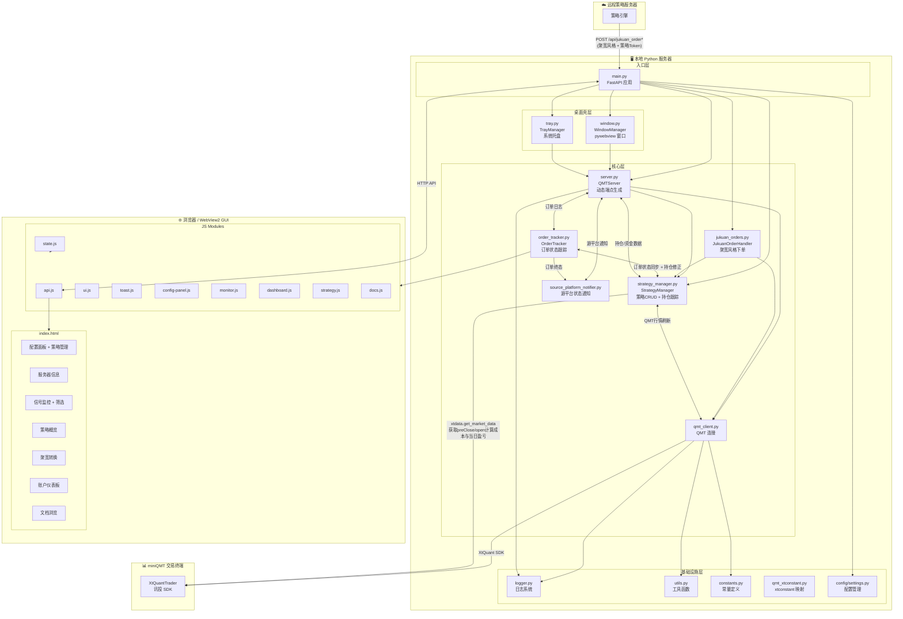
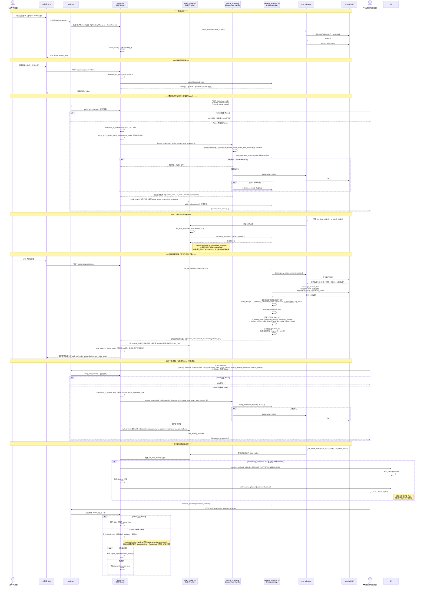
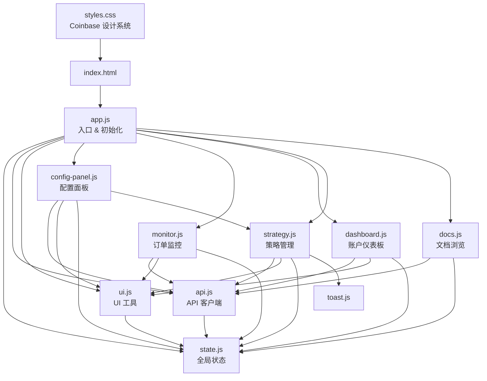
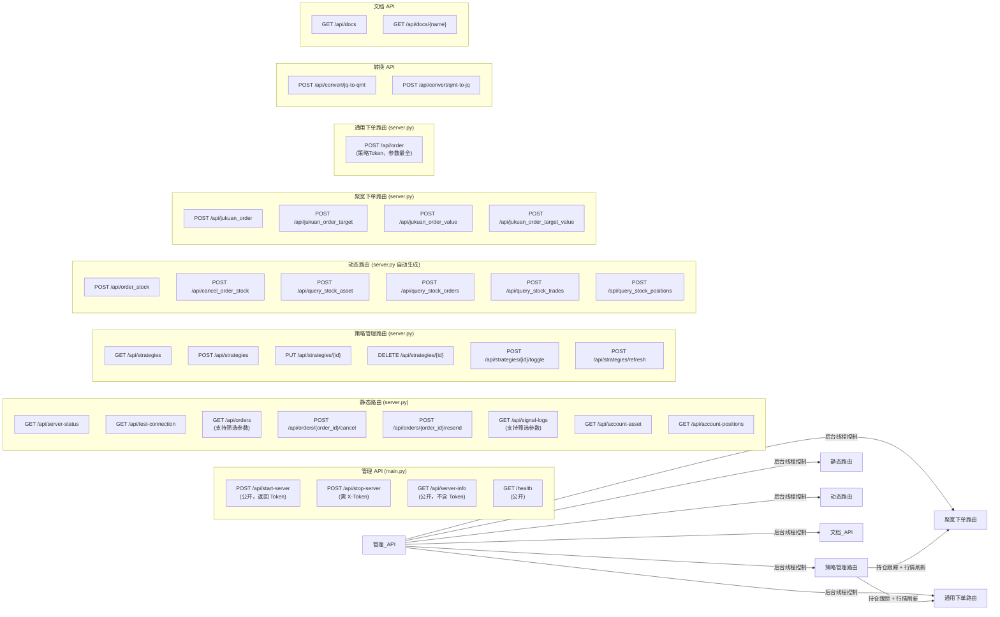

# QMT-live-assistant 实现方案

## Context

根据 PRD.md 构建 miniQMT 量化交易助手：Python 服务器 + 原生 HTML 前端，Coinbase 风格 UI（DESIGN.md）。核心链路：远程聚宽策略服务器 → 本地 FastAPI 服务（策略级校验与记账）→ miniQMT（XtQuant SDK）→ 券商。功能涵盖：多策略管理、策略 Token 认证、聚宽风格下单、订单监控与主动管理、信号日志、桌面窗口/托盘、EXE 打包。

## 技术栈

- **后端**: Python 3.10+ / FastAPI / uvicorn / xtquant SDK / SQLAlchemy 2.0 / Alembic / SQLite
- **前端**: 原生 HTML + CSS + JS（ES Module，无框架）
- **桌面壳**: pywebview（WebView2 窗口）+ pystray（系统托盘）+ PyInstaller（单 exe）

## 项目架构图示

### 1. 整体系统架构



### 2. 核心数据流



### 3. 前端模块依赖图



### 4. API 路由拓扑



---

## 后端架构

### `config/settings.py` — 配置层
环境变量驱动（SERVER_HOST/PORT、MINI_QMT_PATH、ACCOUNT_ID、PERSISTENCE_MODE、DATABASE_URL、LOG_LEVEL 等），新增 `SOURCE_PLATFORM_WEBHOOKS`（JSON 字符串映射 `source_platform -> webhook URL`），带默认值，导出单例 `settings`。

### `backend/constants.py` / `qmt_xtconstant.py` — 常量
ANSI 颜色码、买卖方向（STOCK_BUY=23 / STOCK_SELL=24）；xtquant 委托类型、价格类型（FIX_PRICE / LATEST_PRICE）、订单状态（ORDER_CANCELED / ORDER_SUCCEEDED 等）映射。

### `backend/logger.py` — 日志
控制台 + 按日文件轮转（logs/YYYY-MM-DD.log）；可选企业微信 webhook 推送（`WeChatHandler`）。

### `backend/utils.py` — 工具函数
- **代码转换**：`add_stock_suffix` / `jq_to_qmt` / `qmt_to_jq` / `normalize_to_qmt`（系统边界统一归一化为 QMT 格式 .SZ/.SH/.BJ）
- **行情获取**（无 xtquant 时 fallback 到 mock_xtquant）：`fetch_preclose_from_xtdata` / `fetch_open_prices_from_xtdata` / `fetch_stock_names_from_xtdata` / `fetch_latest_prices_from_xtdata`（`get_full_tick` 的 lastPrice）；异常时记录日志，不再静默吞错
- **QMT 统一调用层**：`qmt_call(trader, method_name, *args, context=None, **kwargs)` 封装所有 xtquant 同步接口调用，捕获异常并检查返回值（`order_stock/-1`、`cancel_order_stock/-1`、`query_*/None`），失败时抛出 `QMTInteractionError` 并记录结构化日志
- **时间**：`timestamp_to_datetime_string` / `convert_to_current_date` / `seconds_until_market_open`（开盘轮询用）

### `backend/qmt_client.py` — QMT 连接层
`create_trader(account_id, mini_qmt_path, callback)` → `(trader, account, callback)`：随机 session_id 创建 XtQuantTrader，start → connect（失败/非 0 抛 `ConnectionError`）→ subscribe（失败/`-1` 抛 `ConnectionError`）→ 注册回调。回调类将 xtquant 事件（`on_stock_order` / `on_stock_trade` / `on_disconnected` / `on_order_error` / `on_cancel_error` 等）转发给 OrderTracker 与连接看门狗；`on_order_error` / `on_cancel_error` 结构化记录 `error_id`、`error_msg`、`account_id`、`order_id`、`market`、`order_sysid` 等字段，并使用有界去重避免内存泄漏。非 Windows 自动降级 mock_xtquant。

### `backend/connection_watchdog.py` — QMT 连接看门狗
`ConnectionState` 状态机（DISCONNECTED / CONNECTING / CONNECTED / RECONNECTING / FAILED）。断线回调信号 + 定期健康检查（query_stock_asset）触发重连，指数退避 + 20% 抖动；断线期间 `qmt_connected=False`，交易/账户接口返回 503，前端展示重连横幅。

### `backend/strategy_manager.py` — 策略管理器
- 模型位于 `backend/models/strategy.py`：`Strategy` / `StrategyCreate` / `StrategyUpdate` / `PositionAssignment`
- CRUD + toggle + 软删除（`deleted_at`）；写操作通过 `model_copy(update=...)` 保持领域模型不可变；`StrategyRepository` 构造函数注入，缺省降级 InMemory 实现
- **`apply_optimistic_position`**（下单前原子冻结）：买入仅冻结资金、不建持仓行，**成本超可用资金返回 None**；卖出校验可用持仓充足后冻结数量，不足返回 None。返回增量快照（delta_cash / delta_frozen_quantity 等）
- **`rollback_position` / `reconcile_position`**：订单失败按快照增量解冻；成交时先回滚快照、再按真实成交数量与价格记账（因此冻结可用估算价，不影响最终账务）
- **`list_all_enriched`**：用 QMT 实时行情富化策略——按持仓占比分摊市值、计算现价；当日盈亏拆分「昨日持仓（现价−昨收）+ 今日买入（现价−买入成本）」；每日首次调用自动跨日合并（今日买入 → 昨日持仓，以 preClose 为新成本基准）
- 持仓以 QMT 格式持久化（代码/名称/数量/avg_cost/今昨拆分字段），行情字段不落库

### `backend/server.py` — 核心服务器
`QMTServer` 集中注册全部路由：
- **策略 CRUD**：`/api/strategies*`；返回前注入 `order_count` 与 pending 买入单的 `frozen_cash`，并将 `frozen_cash` 加回 `total_asset`
- **聚宽下单**：`/api/jukuan_order{,_target,_value,_target_value}` 统一走 `_jukuan_endpoint`：仅策略 Token（主 Token 403）→ 代码归一化 → 调 handler → 注册订单 → 写 signal_logs（成功记 processed_order_id，异常记 error_msg；max_buyable 封顶/取消时记 error_msg 部分下单详情并保留订单关联）；支持 `notify_source` / `source_platform_webhook` / `source_platform` 透传到订单跟踪器
- **通用下单**：`POST /api/order`（策略 Token）使用 `GenericOrderRequest` Pydantic 模型，支持 `direction` / `order_type` / `price_type` / `source_platform` / `notify_source` / `source_platform_webhook` 等全参数，复用 `_submit_order` 冻结链路
- **订单**：`GET /api/orders`（状态/策略/日期筛选）；`POST /api/orders/{id}/cancel`（撤 pending/partial）；`POST /api/orders/{id}/resend`（重发 failed 且未重发过的订单，可选请求体 `OrderResendRequest{quantity, price}` 覆盖原参数，买入非整手 400，资金/持仓不足 400）
- **手动下单**：`POST /api/strategies/{id}/order`（Web UI 主 Token：策略存在/启用校验、代码归一化、买入整手校验，复用 `_submit_order` 冻结链路，写 `manual_order` 交易记录，支持 `notify_source` / `source_platform_webhook` / `source_platform`）；启动时 `_bump_mock_order_counter()` 将 MockTrader 订单号计数器抬升到历史最大订单号之上，避免与已持久化订单冲突覆盖
- **账户/工具**：account-asset、account-positions、代码转换、文档 API、动态端点（trader 方法自动映射）
- **源平台状态通知**：`_register_order_state_callback` 在订单 filled/failed 终态时，若 `notify_source=true` 则解析 webhook URL 并启动 daemon 线程 POST 结构化 payload；通知失败仅记录日志，不影响状态机
- 横切：`verify_token` / `verify_any_token` 鉴权；`_require_qmt_connected` 依赖（断线 503）；`_track_and_apply_order` 注册订单并随单持久化冻结快照与通知参数；`_poll_orders_loop`（5 秒）与 `_market_open_poll_loop`（每日 09:30）两个后台轮询

### `backend/order_tracker.py` — 订单状态跟踪
状态机 pending / partial / filled / failed。启动时从 Repository 恢复 pending 订单；`poll_and_reconcile` 通过 `qmt_call` 轮询 QMT 修正状态；`cancel_order` 调用 `cancel_order_stock` 手动撤销后置 failed；终态触发回调调用 StrategyManager 对账/回滚；`track_order` 携带 `notify_source` / `source_platform_webhook` / `source_platform` 供通知使用；每次状态变更持久化并写 `order_events` 审计。

### `backend/source_platform_notifier.py` — 源平台状态通知
- `resolve_webhook_url(order, mapping)`：优先订单显式 webhook，其次按 `source_platform` 查全局映射
- `build_payload(order)`：构造包含 event / order_id / status / 成交信息 / 时间戳的结构化 JSON
- `notify_source_platform(order, webhook_url)`：同步 `requests.post`，调用方在 daemon 线程执行，失败仅记录日志

### `backend/jukuan_orders.py` — 聚宽风格下单
`JukuanOrderHandler` 实现 4 个聚宽 API 风格方法 + 1 个通用下单方法：
- 策略级取数：`_get_price`（优先策略持仓 avg_cost → 账户持仓 → 行情最新价）、`_get_volume`（优先策略持仓）
- `jukuan_order`（按数量）/ `jukuan_order_target`（目标仓位差额）/ `jukuan_order_value`（按金额）/ `jukuan_order_target_value`（目标市值，委托给 order_value）
- `generic_order`（通用下单）：按 `direction` 或显式 `order_type` 确定委托类型，支持显式 `price_type` 与 `order_remark`，股票买入整手校验，返回含 `price_type` / `order_type` 的统一结果
- **`_submit_order` 原子校验与冻结**：买入先按策略 `insufficient_funds_policy` 处理资金不足——`max_buyable` 时 `_cap_quantity_by_funds_policy` 将数量封顶到可用资金可负担的最大整手数（不足一手返回"订单取消"结果），`reject`（默认）保持原数量；再 `apply_optimistic_position` 冻结（资金/持仓不足抛 ValueError，不发往 QMT）→ `trader.order_stock` → QMT 失败立即 rollback；**市价买入单（price=0）用 `fetch_latest_prices_from_xtdata` 估算成本做校验与冻结**，QMT 仍按市价提交，行情不可用时跳过校验优雅降级；支持显式 `price_type` 与 `order_remark`；返回实际委托 `quantity` 与 `requested_quantity` / `funds_cap_note` 供调用方响应记账、端点标记异常信号日志
- 数量按手数向下取整（股票 100、期货 1）；期货支持 `side='short'`；返回 QMT/聚宽双格式代码与 `optimistic_snapshot`

### `backend/window.py` / `backend/tray.py` — 桌面壳
pywebview 原生窗口（Windows WebView2），关闭最小化到托盘；pystray 托盘菜单（打开界面 / 复制 Token / 退出）。

### `backend/main.py` — 应用入口
FastAPI lifespan + CORS + 前端静态挂载；管理 API（start-server 返回 Token / stop-server / server-info）；按 `PERSISTENCE_MODE` 创建 SQLAlchemy（sqlite）或 InMemory（memory）Repository；CLI argparse 支持 `--account/--qmt-path/--host/--port/--token/--tray/--window` 三种运行模式。

### `backend/mock_xtquant/` — Mock 层
非 Windows 开发与测试用：MockTrader（连接、下单、资产/持仓查询）、MockData（内置 3 只股票的 K 线与 get_full_tick 行情，lastPrice=close）、模拟断线/重连（供看门狗测试）。MockTrader 订单号计数器为类属性（每进程从 100000 重计），提供 `bump_order_counter()` 供服务器启动时抬升，避免与已持久化的历史订单号冲突。

### `backend/db/` — 数据库层
7 张表（accounts、strategies、positions、orders、strategy_tokens、order_events、signal_logs）；orders 表新增 `notify_source_platform`、`source_platform_webhook` 列；strategies 表新增 `insufficient_funds_policy` 列（历史 NULL 行归一为 reject）；Repository 抽象基类 + SQLAlchemy / InMemory 双实现，负责领域模型 ↔ 数据库模型映射；Alembic 管理迁移。

### `backend/models/` — 领域模型
- `strategy.py`：Pydantic 模型 `Strategy` / `StrategyCreate` / `StrategyUpdate` / `PositionAssignment`；`insufficient_funds_policy`（reject / max_buyable）在 API 边界用 Literal 校验
- `order.py`：`TrackedOrder`（dataclass，新增 `notify_source` / `source_platform_webhook` / `source_platform`）、`OrderState` 状态常量、`OrderResendRequest`（Pydantic，重发改参请求体）、`GenericOrderRequest` / `ManualOrderRequest`（新增通知相关字段）
- 解耦业务层与数据库层，消除 Repository 与业务层循环依赖

---

## 前端架构

### HTML 结构（index.html 单页）

```
.top-nav              — 固定顶部导航（Logo + 状态圆点 + 导航链接 + 主题切换）
.main-content
  #account-empty       — 空状态（未连接 / Token 连接表单）
  #config              — 服务器配置表单（必填项不完整时禁用启动/停止按钮）
  #server-info         — 服务器状态卡片
  #strategy-management — 策略管理（列表 + 编辑模态框 + Token 复制）
  #dashboard           — 账户仪表板（4 资产卡片 + 可展开持仓明细）
  #strategy-overview   — 策略概览（资产卡片 + 点击展开持仓明细）
  #monitor             — 订单监控（筛选栏 + 订单列表 + 条数统计）+ 信号日志
  #converter / #docs   — 代码转换工具 / 文档浏览
#strategy-modal / #resend-modal — 策略编辑 / 订单重发弹窗（共用 .modal-overlay 体系）
#toast-container
```

### CSS 设计系统（styles.css，来自 DESIGN.md）
- CSS 自定义属性令牌：颜色/字体/间距/圆角/阴影；主色 #0052ff；亮暗双主题（`data-theme`）
- 盈亏色独立于系统色：`--color-pnl-up: #cf202f`（涨红）、`--color-pnl-down: #05b169`（跌绿）
- 组件：pill 按钮、24px 圆角卡片、模态框（.modal-overlay/.modal/.form-*）、Toast、筛选栏；1024/768/480px 断点

### JS 模块职责

| 模块 | 职责 |
|------|------|
| `app.js` | 入口：DOMContentLoaded 初始化各模块；Token 连接处理（支持 Enter） |
| `state.js` | 全局状态 get/set；Token 持久化 sessionStorage |
| `api.js` | fetch 封装（统一错误处理，后端 detail 抛为 Error）；全部端点方法 |
| `ui.js` | 渲染层：订单列表（含撤销/重发按钮列）、仪表板、策略概览卡片、持仓明细表、Logo 圆点、重连横幅、Tab 切换、配置按钮禁用态 |
| `config-panel.js` | 配置表单提交（启动/停止）、测试连接、表单完整性实时校验 |
| `monitor.js` | 订单/信号日志轮询与筛选；订单操作事件委托（撤销直接调 API，重发打开 `#resend-modal` 弹窗：预填原参数、市价/限价切换、数量与价格校验后提交）；`startStatusCheck` 连接状态轮询 |
| `strategy.js` | 策略列表渲染与 CRUD 模态框（名称/金额必填、"策略可用资金不足时"下拉、持仓分配、数量为 100 整数倍校验）；策略下拉填充；持仓明细买入/卖出按钮与手动下单弹窗（买入自由输入代码、卖出持仓下拉预填现价、数量 100 步进、可用上限校验） |
| `dashboard.js` | 账户资产四卡片刷新；持仓明细展开（loading/错误态） |
| `docs.js` | 文档列表与 Markdown 渲染（marked CDN） |
| `toast.js` | Toast.success/error/warning/info，自动消失 |

---

## 实现历程

> 详细逐文件变更记录见 git 历史；以下为各阶段概要。

- **Phase 1-2：项目骨架与后端核心** ✅ — 目录结构、配置/常量/日志/工具函数、QMT 连接、QMTServer
- **Phase 3-4：策略管理与信号功能** ✅ — StrategyManager（CRUD + 持仓跟踪）、OrderTracker；原 signal_handler 后由聚宽风格下单替代
- **Phase 5-6：测试体系与前端** ✅ — pytest 各层测试；Coinbase 设计系统 + 9 个 JS 模块的单页前端
- **Phase 7：聚宽风格下单** ✅ — qmt_xtconstant 映射 + 4 个 jukuan 下单接口（仅策略 Token）
- **Phase 8-9：桌面壳与打包** ✅ — 托盘 / pywebview 窗口模式；PyInstaller 单 exe
- **Phase 10：集成与文档** ✅ — 端到端集成验证，README 与本文档
- **Phase 11：行情工具重构** ✅ — 行情函数迁移至 utils.py；无持仓时 `get_full_tick` 取最新价支持首次建仓
- **Phase 12：代码归一化** ✅ — `normalize_to_qmt` 统一系统边界代码格式；订单计数替代信号计数；前端文案统一为「订单」
- **Phase 13：数据持久化** ✅ — SQLAlchemy 2.0 + Alembic + SQLite（7 表）；Repository 双实现；领域模型分层（models/）打破循环依赖；策略软删除
- **Phase 14：持仓股票名称补全** ✅ — 买入成交新建持仓时自动从 xtdata 获取名称
- **Phase 15：连接看门狗与订单主动管理** ✅ — 断线检测与指数退避重连；跨终端 Token 连接；每日 09:30 开盘轮询；订单手动撤销/一键重发（`retried_as_order_id` 链路）
- **Phase 16：重发改参与买入资金校验** ✅ — 重发弹窗可修改价格/数量（resend 端点支持可选请求体）；`_freeze_position` 补买入透支检查，全部 5 条买入路径统一校验策略可用资金；市价买入单按最新价估算冻结
- **Phase 17：策略手动下单与 Mock 订单号冲突修复** ✅ — 持仓明细新增买入/卖出按钮与下单弹窗（买入自由输入代码、卖出持仓下拉、数量 100 整数倍步进）；新增 `POST /api/strategies/{id}/order` 主 Token 手动下单端点，复用冻结/校验/跟踪链路并写 `manual_order` 交易记录；修复 MockTrader 订单号计数器每进程重置、与历史持久化订单冲突导致新单覆盖旧单（order_count 不增长、DB 行被改写）的问题——启动时将计数器抬升到历史最大订单号之上
- **Phase 18：QMT 接口错误处理统一化** ✅ — 按 `reference-document/qmt_xtquant_api.md` 将撤单方法修正为 `cancel_order_stock`；新增 `QMTInteractionError` 与 `qmt_call` 统一封装所有 xtquant 同步调用，捕获异常并按文档检查返回值（`order_stock/-1`、`cancel_order_stock/-1`、`query_*/None`）；扩展 `on_order_error` / `on_cancel_error` 结构化日志与有界去重；`create_trader` 统一检查 `connect()` / `subscribe()` 返回值；行情获取函数异常时记录日志；全部测试覆盖新增错误场景
- **Phase 19：策略资金不足处理策略配置** ✅ — 策略新增 `insufficient_funds_policy` 配置项（`reject` 默认"放弃本次下单" / `max_buyable`"按最大可买数量下单"），统一约束全部 6 条买入路径：`_submit_order` 冻结前按可用资金将买入数量封顶到最大整手数，不足一手取消下单（聚宽/通用接口返回"订单取消"，手动下单返回 400）；删除 `jukuan_order_value` 原有无条件静默封顶（**行为变化**：默认 reject 下金额类接口超资拒单）；strategies 表新列 + Alembic 迁移（历史 NULL 归一 reject）；前端策略表单新增下拉配置；响应与记账均以实际委托数量为准；封顶/取消的信号在 signal_logs 记为异常（`error_msg` 注明请求股数与实际下单股数或取消原因，`processed_order_id` 保留订单关联）

---

## 部署方案

### nginx 反向代理

为支持将服务部署在服务器并通过 nginx 反向代理访问，项目已做以下改造：

1. **前端资源相对化**：`frontend/index.html` 中的 CSS/JS 引用使用 `./static/...` 相对路径，兼容根路径（`/`）与子路径（如 `/qmt/`）部署。
2. **前端 API 动态 base URL**：`frontend/js/api.js` 基于 `window.location.pathname` 自动计算 API 前缀，兼容根路径与子路径部署。
3. **后端 `ROOT_PATH` 配置**：通过环境变量 `ROOT_PATH` 设置 FastAPI 的 `root_path`。静态文件在内部固定挂载到 `/static` 与 `/docs-assets`；nginx 子路径代理时会剥离 `ROOT_PATH` 前缀，前端通过相对路径自动拼接外部子路径。文档内图片链接由后端根据 `ROOT_PATH` 生成绝对路径。
4. **CORS 可配置**：通过 `CORS_ALLOW_ORIGINS` 与 `CORS_ALLOW_CREDENTIALS` 配置跨域；当 origins 为 `*` 时强制不允许携带凭证，避免浏览器拒绝。
5. **URL 构建工具**：`backend/utils.py` 新增 `build_server_url(host, port, root_path)`，桌面窗口与托盘统一使用它来构造访问地址。

### nginx 配置示例

**根路径代理**：

```nginx
server {
    listen 443 ssl;
    server_name example.com;

    location / {
        proxy_pass http://127.0.0.1:8000;
        proxy_http_version 1.1;
        proxy_set_header Host $host;
        proxy_set_header X-Real-IP $remote_addr;
        proxy_set_header X-Forwarded-For $proxy_add_x_forwarded_for;
        proxy_set_header X-Forwarded-Proto $scheme;
    }
}
```

**子路径代理**（推荐通过 `ROOT_PATH` 实现）：

```nginx
server {
    listen 443 ssl;
    server_name example.com;

    location /qmt/ {
        proxy_pass http://127.0.0.1:8000/;
        proxy_http_version 1.1;
        proxy_set_header Host $host;
        proxy_set_header X-Real-IP $remote_addr;
        proxy_set_header X-Forwarded-For $proxy_add_x_forwarded_for;
        proxy_set_header X-Forwarded-Proto $scheme;
        proxy_set_header X-Forwarded-Prefix /qmt;
    }
}
```

后端启动：

**Linux / macOS：**

```bash
ROOT_PATH=/qmt python -m backend.main --port 8000
```

**Windows cmd：**

```cmd
set ROOT_PATH=/qmt
python -m backend.main --port 8000
```

**Windows PowerShell：**

```powershell
$env:ROOT_PATH="/qmt"
python -m backend.main --port 8000
```

**跨平台推荐（`.env` 文件）：**

应用启动时会自动读取项目根目录下的 `.env` 文件，所有平台均可直接把配置写在文件里，避免命令行环境变量语法差异。

```bash
# 复制示例文件并按需修改
cp .env.example .env
```

`.env` 示例内容：

```env
ROOT_PATH=/qmt
CORS_ALLOW_ORIGINS=https://example.com
```

`.env` 已被 `.gitignore` 忽略，不会提交到仓库。

### 环境变量

| 变量 | 默认值 | 说明 |
|------|--------|------|
| `ROOT_PATH` | `` | FastAPI 子路径，如 `/qmt` |
| `BASE_URL` | `` | 外部访问 URL 前缀 |
| `CORS_ALLOW_ORIGINS` | `*` | 允许跨域来源，多个用逗号分隔 |
| `CORS_ALLOW_CREDENTIALS` | `false` | 是否允许跨域携带凭证 |

---

## 验证方案

**后端测试**
1. `pytest tests/ -v` 全部通过
2. macOS 上 `python -m backend.main` mock 模式启动成功

**下单与资金**
3. 策略 Token 调 `/api/jukuan_order` → 自动下单、OrderTracker 记录、策略持仓与资金更新；主 Token 调用返回 403
4. 买入成本超策略可用资金（任意买入路径）→ 拒绝并提示"策略可用资金不足"，无订单生成、资金不变；并发多笔买入不超冻
5. 卖出超策略可用持仓 → 拒绝并提示"策略可用持仓不足"
6. `/api/jukuan_order_value` 对无持仓股票 → 自动取最新价计算数量；默认 reject 下买入金额超可用资金拒单，策略配置为 max_buyable 时按最大可买数量下单

**订单管理**
7. 制造 pending 订单点「撤销」→ 状态变 failed、冻结资金释放
8. 制造 failed 订单点「重发」→ 弹窗预填原参数（限价填价、市价隐藏价格行）；改数量/价格提交 → 新订单按新参数生成，原单记录 `retried_as_order_id`；买入非整手前端拦截；已重发的订单不再显示重发按钮
9. 订单筛选（状态/日期/策略）与底部条数统计正确；策略卡片「订单 N 笔」点击跳转并自动筛选
10. 展开策略持仓明细 → 买入/卖出按钮跟随显隐；买入自由输入代码（聚宽格式自动归一化）、卖出从持仓下拉选择（预填现价与可用提示）；数量按 100 步进、买入非整手拦截、卖出超可用拦截；禁用策略下单被拒；下单成功后策略订单计数 +1

**策略与持仓**
11. 创建策略（可选分配账户持仓）→ 编辑/删除/启停；持仓总成本不超分配金额
12. 刷新行情 → preClose 正确、当日盈亏按今昨拆分计算；跨日自动合并
13. 买入成交新股票 → 策略持仓自动补全股票名称

**连接与安全**
14. 模拟 QMT 断线 → Logo 圆点变黄/灰、重连横幅展示，交易/账户接口 503；恢复后变绿并提示
15. 无 Token 的新标签页输入主 Token 连接 → 进入完整管理视图

**UI 与其他**
16. 仪表板当日盈亏颜色正确（正红负绿）；持仓/策略卡片展开先 loading 后渲染，失败显示错误提示
17. 信号日志默认展示异常；`received_at` 带 UTC 时区，前端按本地时区展示无偏差
18. 代码转换（jq ↔ qmt、normalize_to_qmt）行为正确
19. `--window` / `--tray` 模式与 PyInstaller 打包 exe 验证
20. 配置表单必填项不完整时启动/停止按钮禁用
21. 模拟 QMT `order_stock` / `cancel_order_stock` 返回 `-1` 或 `query_stock_asset` 返回 `None` → 服务端记录结构化错误日志并返回 HTTP 500，策略乐观持仓正确回滚
22. `POST /api/orders/{order_id}/cancel` 正常撤单 → 订单状态变 failed，Mock 内部走 `cancel_order_stock`，冻结资金释放
23. 策略配置"按最大可买数量下单"→ 各买入路径（按数量/目标仓位/按金额/目标市值/通用下单/手动下单）超资按最大整手数成交、冻结金额与订单数量以封顶后为准；不足一手时聚宽/通用接口返回"订单取消"、手动下单返回 400；改回默认"放弃本次下单"后超资拒单；封顶/取消的信号在信号日志中记为异常并注明请求股数与实际下单股数，未封顶信号不标记
